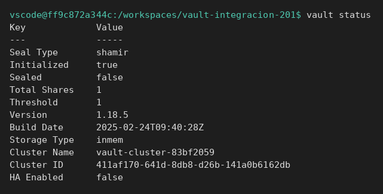
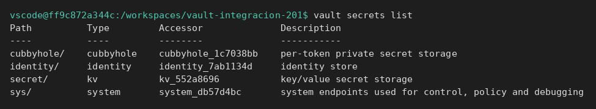
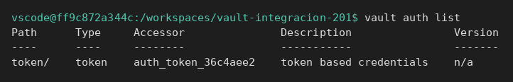

# Arquitectura de Vault

[← Página anterior](README.md) · [Siguiente página →](01-lab-primer-secreto.md)

Una aplicación no «abre Vault». Pide un token a un método de autenticación y, con ese token, lee un camino de un motor de secretos. La policy decide si ese token puede leer ese camino. Esta página se sigue sola: el servidor se crea aquí.

## Punto de partida

Desde la raíz del repositorio, en una terminal:

```bash
bash infra/reiniciar-vault.sh
source infra/entorno.sh
```

Queda `VAULT_ADDR=http://127.0.0.1:8200` y `VAULT_TOKEN=root`. El proceso es el contenedor `vault-dev`, imagen `hashicorp/vault:1.18`, modo dev. Al recrearlo, la memoria se vacía.

## Recorrido

1. Al pedir el estado, Vault responde que está inicializado y no sellado. En este laboratorio `Seal Type` es `shamir`, pero el modo dev ya lo ha desellado solo. En producción, después de un reinicio, el nodo no sirve secretos hasta el unseal.

```bash
vault status
```

La salida muestra `Initialized` a `true` y `Sealed` a `false`. También aparece la versión del servidor.



2. Al listar los motores, el camino `secret/` ya existe y es de tipo `kv`. Ahí se guardan los secretos estáticos de este curso. Otros motores (base de datos, PKI, transit) no vienen habilitados: si una integración de SELAE usa otro, el camino y el JSON de la API cambian, y el síntoma en la prueba no es el mismo.

```bash
vault secrets list
```

En la tabla, la fila `secret/` tiene engine `kv`.



3. Al listar la autenticación, el método `token/` está habilitado. Es el que usa el token `root` de este laboratorio. UserPass y AppRole se habilitan en el módulo 4; no aparecen todavía, y no hace falta haberlos visto para entender este mapa.

```bash
vault auth list
```

La fila `token/` está presente.



4. Un secreto de aplicación, en este curso, vive en un camino del estilo `secret/pagos/api`. La policy nombra ese camino. El token es la credencial que la policy acepta o rechaza. Esas tres palabras —camino, policy, token— son el vocabulario de un fallo de integración.

## Qué queda visto

El servidor de laboratorio está vacío, desellado, con KV en `secret/` y auth por token. El [laboratorio del primer secreto](01-lab-primer-secreto.md) vuelve a crear el servidor: no depende de dejar esta página a medias.
