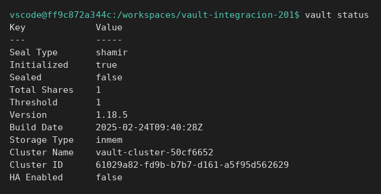
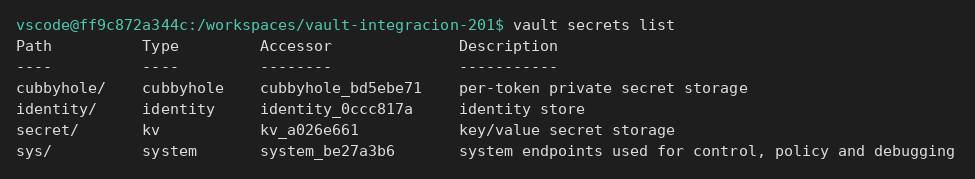
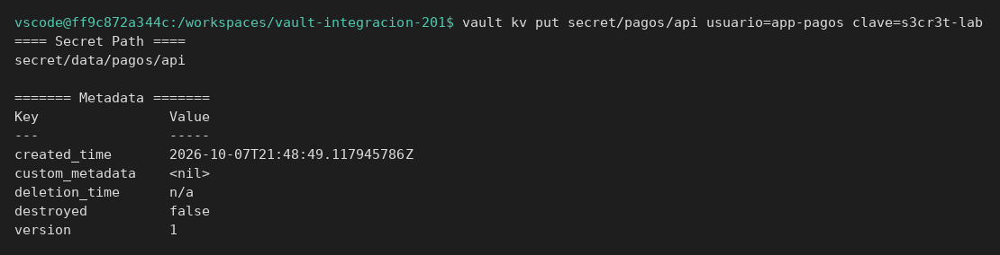
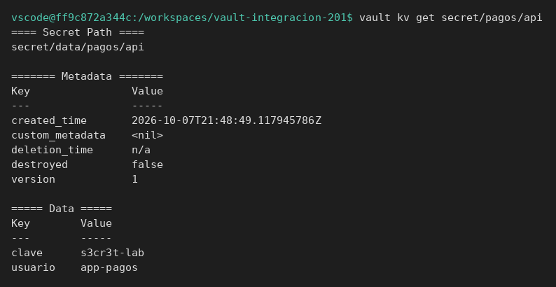
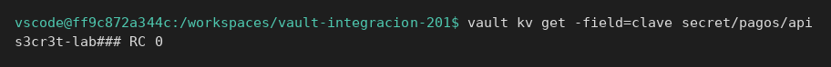
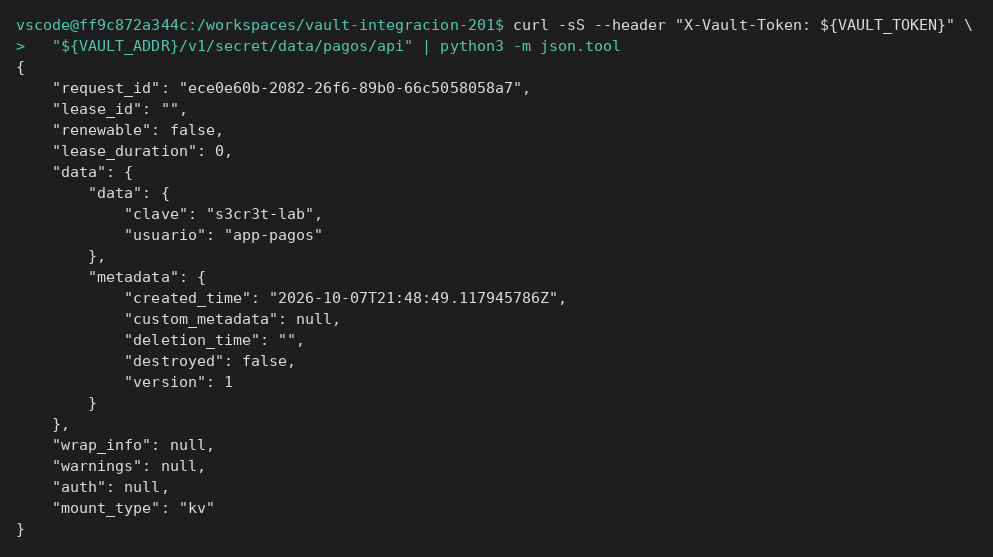
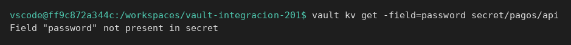
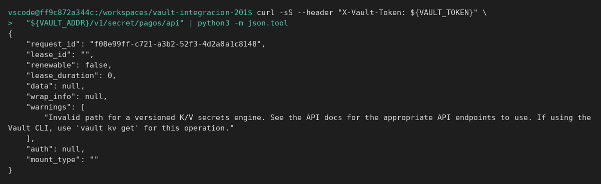
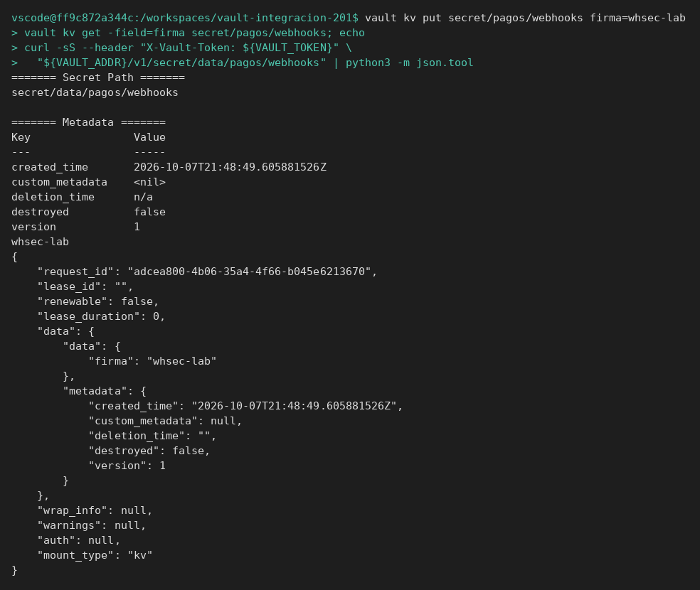

# Primer secreto

[← Página anterior](00-arquitectura-vault.md) · [Siguiente página →](../M02-secretos-y-api/README.md)

Vas a dejar escrito el secreto de una API de pagos y a leerlo por la CLI y por HTTP. Es el mismo gesto que hará la aplicación cuando la pruebes.

### Objetivo

Dejar en `secret/pagos/api` la clave `s3cr3t-lab` y leerla con `vault kv get` y con `curl`, en un servidor que acabas de crear.

### Punto de partida

Desde la raíz del repo. Esto borra cualquier Vault anterior del laboratorio y exporta las variables **en esta terminal**:

```bash
bash infra/reiniciar-vault.sh
source infra/entorno.sh
```

- URL: `http://127.0.0.1:8200`
- Token: `root` (solo este laboratorio)
- Estado: servidor vacío, motor `secret/` ya habilitado

Si abres otra terminal, vuelve a ejecutar `source infra/entorno.sh`. No hace falta haber seguido la página de arquitectura.

### En qué consiste

Compruebas que el servidor responde, escribes un secreto de dos campos, lo lees por CLI pidiendo un solo campo y repites la lectura por la API REST. No tocas policies ni usuarios.

### 1 — Comprueba que Vault responde

**Acción:**

```bash
vault status
```

**Por qué:** si esto falla, el resto de la integración fallará por red o por contenedor, no por el secreto. Conviene separarlo antes de culpar a la aplicación.

**Resultado esperado:** el comando termina sin error. `Sealed` es `false` y `Initialized` es `true`.



### 2 — Mira qué motores hay

**Acción:**

```bash
vault secrets list
```

**Por qué:** el secreto va a `secret/`, que es KV. Si más adelante una prueba apunta a otro prefijo, no es el mismo motor.

**Resultado esperado:** una fila `secret/` con engine `kv`.



### 3 — Escribe el secreto de la API

**Acción:**

```bash
vault kv put secret/pagos/api usuario=app-pagos clave=s3cr3t-lab
```

**Por qué:** este es el dato que la aplicación debería recibir. El camino `secret/pagos/api` es el contrato: la prueba y el código tienen que usar el mismo.

**Resultado esperado:** una línea `created_time` y `version` igual a `1`. No imprime el valor en claro en ese resumen.



### 4 — Léelo entero

**Acción:**

```bash
vault kv get secret/pagos/api
```

**Por qué:** confirmas que los dos campos han quedado guardados y que la versión es la 1. Es la lectura que harías al investigar «la app dice que la clave no vale».

**Resultado esperado:** bajo `Data`, `usuario` es `app-pagos` y `clave` es `s3cr3t-lab`. `Version` es `1`.



### 5 — Lee solo el campo que usaría la aplicación

**Acción:**

```bash
vault kv get -field=clave secret/pagos/api
```

**Por qué:** un script no quiere el bloque entero. Quiere la cadena para inyectarla. Si el campo no se llama `clave`, aquí se ve el error de contrato.

**Resultado esperado:** una sola línea, `s3cr3t-lab`, sin cabeceras.



> [!TIP]
> `vault kv get -field` no imprime un salto de línea al final. Si pegas otro comando detrás, el siguiente prompt o el siguiente valor se pegan a la clave. Un `; echo` los separa.

### 6 — Lee el mismo dato por HTTP

**Acción:**

```bash
curl -sS --header "X-Vault-Token: ${VAULT_TOKEN}" \
  "${VAULT_ADDR}/v1/secret/data/pagos/api" | python3 -m json.tool
```

**Por qué:** la aplicación no llama a `vault kv`. Llama a la API. El camino HTTP de un KV v2 lleva `/data/` en medio: `secret/data/pagos/api`, no `secret/pagos/api`. Confundirlos da un 404 aunque el secreto exista.

**Resultado esperado:** un JSON con `"clave":"s3cr3t-lab"` dentro de `data.data`. También ves `"version":1` dentro de `data.metadata`.



> [!WARNING]
> El token va en la cabecera `X-Vault-Token`. Sin esa cabecera la API responde 403 aunque la URL sea correcta.

## Comprueba tu entendimiento

**Campo equivocado**
`vault kv get -field=password secret/pagos/api`
→ El comando falla. El campo que existe es `clave`, no `password`. El secreto sigue en su sitio: no lo has borrado.



**Camino HTTP sin `/data/`**
`curl -sS --header "X-Vault-Token: ${VAULT_TOKEN}" "${VAULT_ADDR}/v1/secret/pagos/api" | python3 -m json.tool`
→ HTTP sería 404. El JSON no trae `s3cr3t-lab`: `data` es `null` y `warnings` dice `Invalid path for a versioned K/V secrets engine`. El camino de lectura es `/v1/secret/data/pagos/api`.



## Reto

### 1 — Segundo secreto, misma API

Crea `secret/pagos/webhooks` con el campo `firma` igual a `whsec-lab`. Léelo por CLI pidiendo solo `firma` y después por `curl`, con el `/data/` correcto.

<details>
<summary>Ver solución</summary>

```bash
vault kv put secret/pagos/webhooks firma=whsec-lab
vault kv get -field=firma secret/pagos/webhooks; echo
curl -sS --header "X-Vault-Token: ${VAULT_TOKEN}" \
  "${VAULT_ADDR}/v1/secret/data/pagos/webhooks" | python3 -m json.tool
```

`firma` sale `whsec-lab` en los dos sitios. `version` es `1`.



</details>

## Errores frecuentes

| Síntoma | Causa probable | Cómo arreglarlo |
|---------|----------------|-----------------|
| `connection refused` en el 8200 | El contenedor no está arriba | `bash infra/reiniciar-vault.sh` y otra vez `source infra/entorno.sh` |
| `vault: command not found` y tampoco funciona la función | No has hecho `source` | `source infra/entorno.sh` en esa terminal |
| 403 en el `curl` | Falta `X-Vault-Token` o `VAULT_TOKEN` está vacío | Repite el `source`. La cabecera tiene que llevar `root` |
| 404 con el secreto recién creado | URL sin `/data/` | Usa `/v1/secret/data/pagos/api` |
