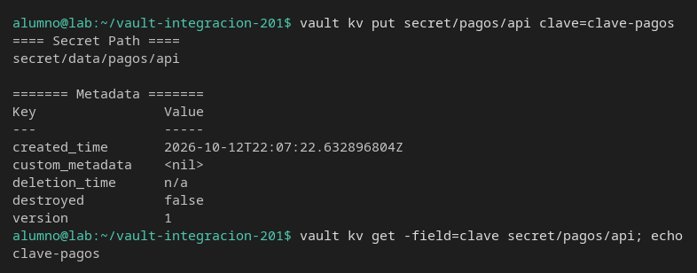
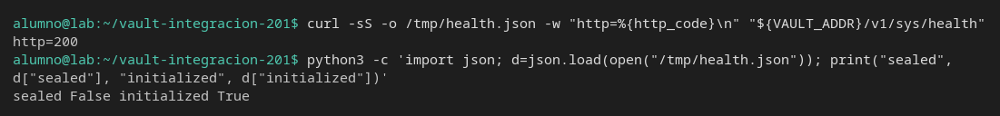
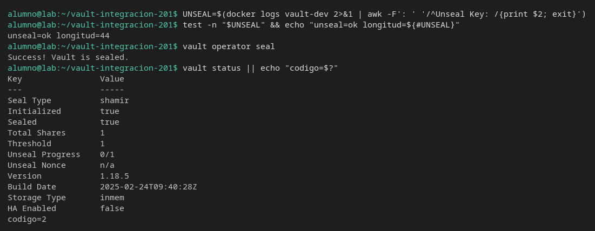
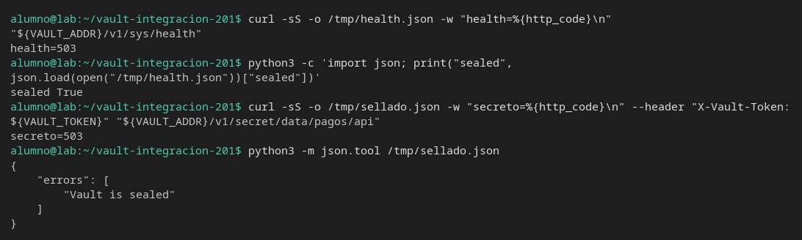
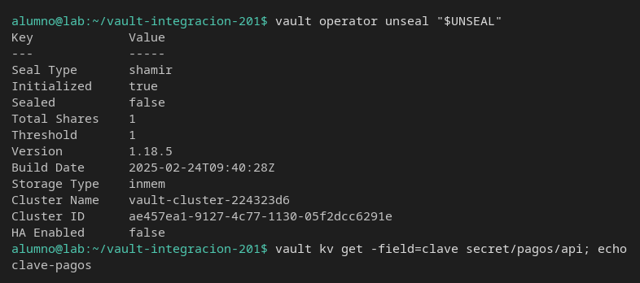

# Sellado y salud

[← Página anterior](02-lab-primer-secreto.md) · [Siguiente página →](04-lab-dos-motores.md)

Vas a sellar el Vault del laboratorio y ver qué responde la API. Un nodo sellado no es un 403 ni una red caída: el secreto sigue ahí y el código HTTP es otro.

### Objetivo

Dejar `secret/pagos/api` escrito, comprobar que sellado responde HTTP 503, desellar y leer la misma clave.

### Punto de partida

```bash
bash infra/reiniciar-vault.sh
source infra/entorno.sh
```

- URL: `http://127.0.0.1:8200`
- Token: `root`
- Estado: servidor vacío y desellado. El modo dev imprime la clave de unseal en el log del contenedor. En producción esa clave no se lee así.

### En qué consiste

Escribes un secreto, miras `/v1/sys/health`, sellas, repites la lectura y desellas. No creas policies ni usuarios.

### 1 — Escribe el secreto que tiene que sobrevivir

**Acción:**

```bash
vault kv put secret/pagos/api clave=clave-pagos
vault kv get -field=clave secret/pagos/api; echo
```

**Por qué:** si sellas un servidor vacío, no puedes demostrar que el sellado no borra el dato.

**Resultado esperado:** `version` es `1`. La lectura imprime `clave-pagos`.



### 2 — Mira la salud con el nodo desellado

**Acción:**

```bash
curl -sS -o /tmp/health.json -w "http=%{http_code}\n" \
  "${VAULT_ADDR}/v1/sys/health"
python3 -c 'import json; d=json.load(open("/tmp/health.json")); print("sealed", d["sealed"], "initialized", d["initialized"])'
```

**Por qué:** un monitor de integración llama a este camino, no a `vault kv`. El código HTTP dice el estado antes de culpar al secreto.

**Resultado esperado:** `http=200`, `sealed False`, `initialized True`.



### 3 — Guarda la clave de unseal sin imprimirla

**Acción:**

```bash
UNSEAL=$(docker logs vault-dev 2>&1 | awk -F': ' '/^Unseal Key: /{print $2; exit}')
test -n "$UNSEAL" && echo "unseal=ok longitud=${#UNSEAL}"
```

**Por qué:** desellar exige esa clave. El modo dev la escribe en el log al arrancar. Mostrarla en pantalla no aporta nada al test: basta saber que la variable no está vacía.

**Resultado esperado:** `unseal=ok longitud=44`.

> [!WARNING]
> Si `UNSEAL` sale vacío, el `awk` no ha visto la línea `Unseal Key:` de este arranque. Repite `bash infra/reiniciar-vault.sh`, vuelve a hacer `source infra/entorno.sh` y este paso.

### 4 — Sella

**Acción:**

```bash
vault operator seal
```

**Por qué:** este es el corte. A partir de aquí la API no entrega secretos aunque el proceso siga vivo y el token `root` sea el mismo.

**Resultado esperado:** `Success! Vault is sealed.`

### 5 — Lee el estado

**Acción:**

```bash
vault status || echo "codigo=$?"
```

**Por qué:** `vault status` con el nodo sellado imprime la tabla y termina con código 2. Un script con `set -e` se para aquí aunque Vault no esté caído.

**Resultado esperado:** `Sealed` es `true`. La última línea es `codigo=2`.



### 6 — Pide el secreto y la salud

**Acción:**

```bash
curl -sS -o /tmp/health.json -w "health=%{http_code}\n" \
  "${VAULT_ADDR}/v1/sys/health"
python3 -c 'import json; print("sealed", json.load(open("/tmp/health.json"))["sealed"])'
curl -sS -o /tmp/sellado.json -w "secreto=%{http_code}\n" \
  --header "X-Vault-Token: ${VAULT_TOKEN}" \
  "${VAULT_ADDR}/v1/secret/data/pagos/api"
python3 -m json.tool /tmp/sellado.json
```

**Por qué:** el síntoma que tiene que reconocer el test es 503 y el texto `Vault is sealed`. No es 403 (eso sería la policy) ni un timeout (eso sería la pausa del proceso).

**Resultado esperado:** `health=503` y `sealed True`. `secreto=503`. El JSON del secreto tiene `"Vault is sealed"` y no trae `clave-pagos`.



### 7 — Desella y comprueba que el dato sigue

**Acción:**

```bash
vault operator unseal "$UNSEAL"
vault kv get -field=clave secret/pagos/api; echo
```

**Por qué:** sellar bloquea la lectura. No crea una versión nueva ni borra `secret/pagos/api`. Si tras desellar la clave hubiera cambiado, el test estaría mirando otra cosa.

**Resultado esperado:** en la tabla, `Sealed` es `false`. La lectura imprime `clave-pagos`.



> [!WARNING]
> Si cierras la terminal con el nodo sellado, el siguiente comando no lee secretos. `vault operator unseal "$UNSEAL"` lo abre. Si perdiste la variable, `bash infra/reiniciar-vault.sh` levanta un servidor nuevo (y vacío).

## Comprueba tu entendimiento

**Salud otra vez, ya desellado**
Repite el `curl` de `/v1/sys/health`.
→ `http=200` y `sealed` es `false`.

## Reto

### 1 — Una clave que no es la de este arranque

Sella, intenta desellar con `AAAAAAAAAAAAAAAAAAAAAAAAAAAAAAAAAAAAAAAAAAA=` y mira `vault status`. Después desella con `$UNSEAL`.

<details>
<summary>Ver solución</summary>

```bash
vault operator seal
vault operator unseal "AAAAAAAAAAAAAAAAAAAAAAAAAAAAAAAAAAAAAAAAAAA=" || true
vault status || echo "codigo=$?"
vault operator unseal "$UNSEAL"
```

El unseal falso responde 400 y el texto `message authentication failed`. `Sealed` sigue en `true` y el código de `vault status` es 2. Con `$UNSEAL`, `Sealed` pasa a `false`.

</details>

## Errores frecuentes

| Síntoma | Causa probable | Cómo arreglarlo |
|---------|----------------|-----------------|
| `unseal=ok` no aparece | No hay línea `Unseal Key:` en el log de este contenedor | Reinicia con `bash infra/reiniciar-vault.sh` y repite el paso 3 |
| Todo responde 503 y no has sellado a propósito | El nodo se quedó sellado en un intento anterior | `vault operator unseal "$UNSEAL"` o reinicia el laboratorio |
| `vault status` corta un script | El código 2 es «sellado», no «comando inexistente» | Mira `Sealed` en la tabla. Para seguir en un script: `vault status \|\| true` |
| Tras desellar la clave no está | Reiniciaste el contenedor en medio | El modo dev no guarda nada al recrearse. Vuelve al paso 1 |
