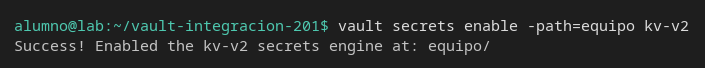
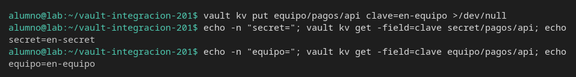
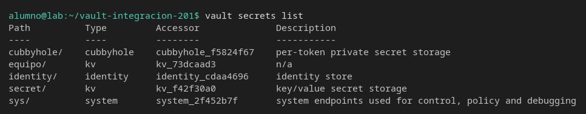
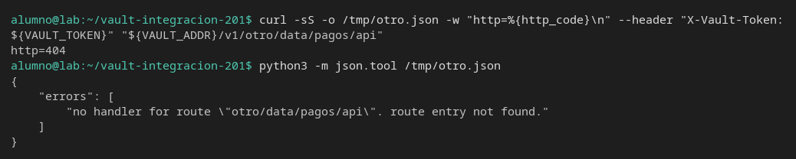

# Dos motores

[← Página anterior](03-lab-sellado.md) · [Siguiente página →](../M02-secretos-y-api/README.md)

El camino `secret/pagos/api` no es «el secreto de pagos». Es ese nombre dentro del motor montado en `secret/`. Vas a montar otro KV y ver que el mismo sufijo guarda otro valor.

### Objetivo

Tener `clave=en-secret` en `secret/pagos/api` y `clave=en-equipo` en `equipo/pagos/api`, y un 404 cuando el prefijo del motor no existe.

### Punto de partida

```bash
bash infra/reiniciar-vault.sh
source infra/entorno.sh
```

Servidor vacío. El motor `secret/` ya está habilitado. `equipo/` no existe hasta que lo habilites en esta página.

### En qué consiste

Escribes en el motor de siempre, habilitas un segundo KV v2, escribes el mismo sufijo con otro valor y comparas las dos lecturas y la API.

### 1 — Escribe en el motor que ya existe

**Acción:**

```bash
vault kv put secret/pagos/api clave=en-secret
```

**Por qué:** este es el contrato que ya conocerías de una prueba. El siguiente paso no debe pisarlo.

**Resultado esperado:** `version` es `1` en `secret/data/pagos/api`.

### 2 — Habilita un segundo KV

**Acción:**

```bash
vault secrets enable -path=equipo kv-v2
```

**Por qué:** un motor es un montaje. `equipo/` y `secret/` no comparten versiones ni valores. Si la aplicación apunta al montaje equivocado, la prueba no está leyendo el secreto que cree.

**Resultado esperado:** `Success! Enabled the kv-v2 secrets engine at: equipo/`.



### 3 — Escribe el mismo sufijo en el motor nuevo

**Acción:**

```bash
vault kv put equipo/pagos/api clave=en-equipo
```

**Por qué:** el sufijo `pagos/api` se repite a propósito. Lo que cambia es el montaje, que es parte del contrato.

**Resultado esperado:** `version` es `1` en `equipo/data/pagos/api`. No dice nada de `secret/`.

### 4 — Lee los dos

**Acción:**

```bash
echo -n "secret="; vault kv get -field=clave secret/pagos/api; echo
echo -n "equipo="; vault kv get -field=clave equipo/pagos/api; echo
```

**Por qué:** si fueran el mismo sitio, las dos líneas coincidirían. No coinciden: la prueba tiene que nombrar el montaje.

**Resultado esperado:** `secret=en-secret` y `equipo=en-equipo`.



### 5 — Lista los montajes

**Acción:**

```bash
vault secrets list
```

**Por qué:** antes de depurar un 404, mira si el prefijo existe. `cubbyhole/`, `identity/` y `sys/` salen siempre; no son el KV de la aplicación.

**Resultado esperado:** hay una fila `secret/` y otra `equipo/`, las dos con type `kv`.



### 6 — Pide un montaje que no existe

**Acción:**

```bash
curl -sS -o /tmp/otro.json -w "http=%{http_code}\n" \
  --header "X-Vault-Token: ${VAULT_TOKEN}" \
  "${VAULT_ADDR}/v1/otro/data/pagos/api"
python3 -m json.tool /tmp/otro.json
```

**Por qué:** `otro/` no se ha habilitado. El 404 de «no hay handler» no es el 404 de un secreto ausente dentro de `secret/`. El cuerpo lo dice: `no handler for route`.

**Resultado esperado:** `http=404` y un error `no handler for route "otro/data/pagos/api"`. No aparece `en-secret` ni `en-equipo`.



> [!TIP]
> En el motor `equipo/` la API también lleva `/data/`: `/v1/equipo/data/pagos/api`. Sin `/data/` el KV v2 responde camino inválido, igual que en `secret/`.

## Comprueba tu entendimiento

**El motor nuevo por HTTP**
`curl -sS --header "X-Vault-Token: ${VAULT_TOKEN}" "${VAULT_ADDR}/v1/equipo/data/pagos/api" | python3 -m json.tool`
→ HTTP 200 y `data.data.clave` es `en-equipo`. `secret/pagos/api` no se ha movido.

## Reto

### 1 — Nóminas solo en un motor

Crea `equipo/nominas/api` con `clave=solo-equipo`. Lee ese camino por HTTP y pide el mismo sufijo bajo `secret/`.

<details>
<summary>Ver solución</summary>

```bash
vault kv put equipo/nominas/api clave=solo-equipo
curl -sS -o /tmp/eq.json -w "equipo=%{http_code}\n" \
  --header "X-Vault-Token: ${VAULT_TOKEN}" \
  "${VAULT_ADDR}/v1/equipo/data/nominas/api"
python3 -c 'import json; print(json.load(open("/tmp/eq.json"))["data"]["data"]["clave"])'
curl -sS -o /tmp/se.json -w "secret=%{http_code}\n" \
  --header "X-Vault-Token: ${VAULT_TOKEN}" \
  "${VAULT_ADDR}/v1/secret/data/nominas/api"
python3 -c 'import json; print(json.load(open("/tmp/se.json"))["data"])'
```

`equipo=200` y la clave es `solo-equipo`. `secret=404`: ese sufijo no está en el otro motor.

</details>

## Errores frecuentes

| Síntoma | Causa probable | Cómo arreglarlo |
|---------|----------------|-----------------|
| `path is already in use` al habilitar `equipo/` | Ya lo habías habilitado en este contenedor | Sigue en el `vault kv put` de `equipo/pagos/api` |
| Las dos lecturas muestran el mismo valor | Escribiste las dos veces en `secret/` | Repite el put de `equipo/pagos/api` con `clave=en-equipo` |
| 404 en `equipo` con el secreto recién creado | Falta `/data/` en la URL | Usa `/v1/equipo/data/pagos/api` |
