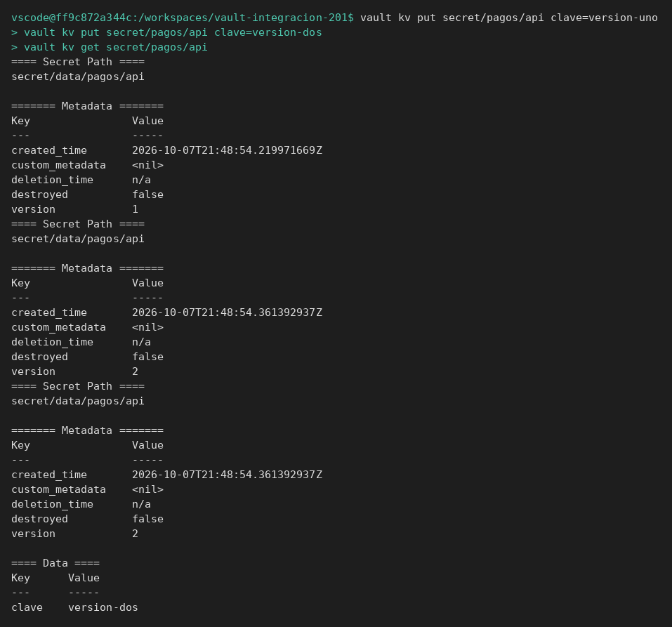
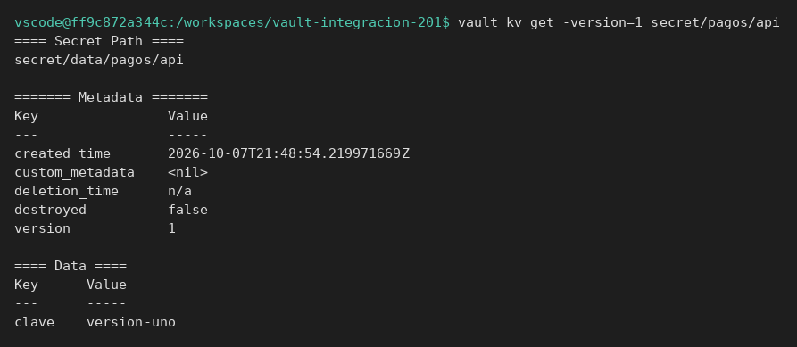
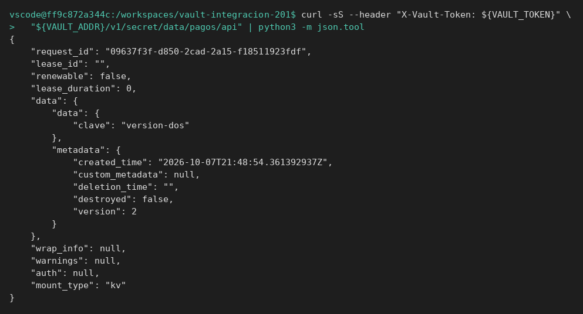
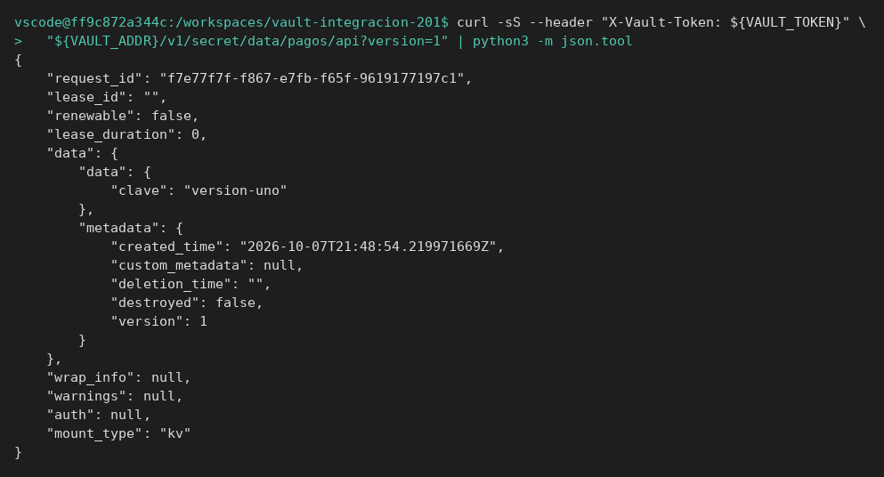

# CLI, API y KV

[← Página anterior](README.md) · [Siguiente página →](01-lab-versiones-y-api.md)

Esta página deja dos versiones de un secreto y enseña dónde mira la aplicación. Se hace en un servidor nuevo: no hereda el secreto del módulo 1.

## Punto de partida

```bash
bash infra/reiniciar-vault.sh
source infra/entorno.sh
```

`VAULT_ADDR=http://127.0.0.1:8200`, token `root`.

## Recorrido

1. Al escribir dos veces el mismo camino, Vault no sustituye la ficha en silencio. La segunda escritura es la versión 2. La primera sigue disponible.

```bash
vault kv put secret/pagos/api clave=version-uno
vault kv put secret/pagos/api clave=version-dos
vault kv get secret/pagos/api
```

La lectura sin versión muestra `clave=version-dos` y `Version` `2`.



2. Al pedir la versión 1, el valor antiguo sigue ahí. Una prueba que no dice qué versión espera puede dar por buena una clave que la aplicación ya no usa, o al revés.

```bash
vault kv get -version=1 secret/pagos/api
```

`clave` es `version-uno`.



3. Al llamar a la API, el JSON separa el dato (`data.data`) de la ficha de versión (`data.metadata`). El número de versión que tiene que afirmar un test está en `metadata.version`, no suelto en la raíz.

```bash
curl -sS --header "X-Vault-Token: ${VAULT_TOKEN}" \
  "${VAULT_ADDR}/v1/secret/data/pagos/api" | python3 -m json.tool
```

`data.data.clave` es `version-dos`. `data.metadata.version` es `2`.



4. La misma URL con `?version=1` devuelve la clave antigua. Es el parámetro que usa una prueba cuando quiere fijar la versión y no «lo último».

```bash
curl -sS --header "X-Vault-Token: ${VAULT_TOKEN}" \
  "${VAULT_ADDR}/v1/secret/data/pagos/api?version=1" | python3 -m json.tool
```

`data.data.clave` es `version-uno`.



## Qué queda visto

Hay un secreto con dos versiones. El [laboratorio](01-lab-versiones-y-api.md) reinicia Vault y vuelve a crearlas: no continúa este servidor.
