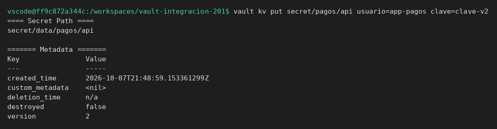
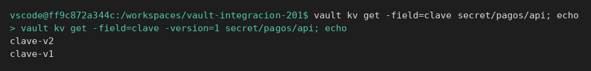
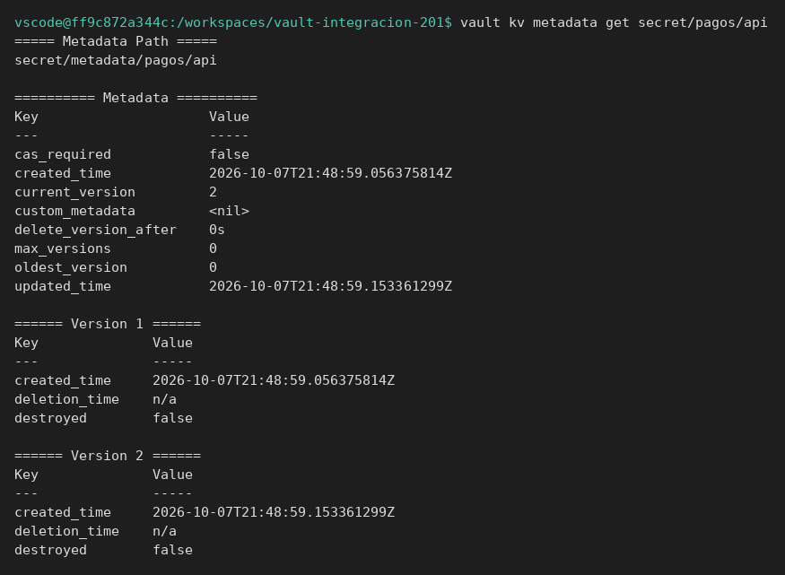
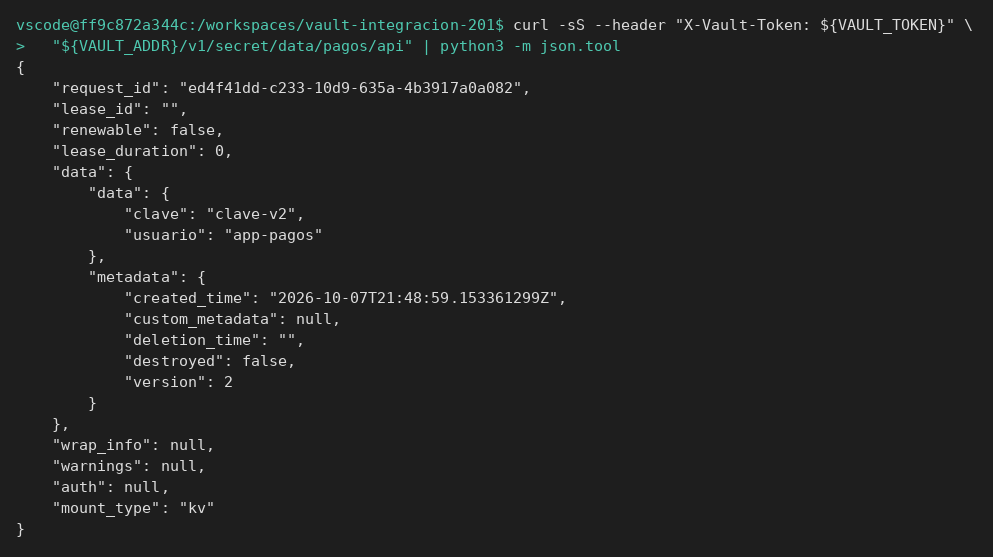
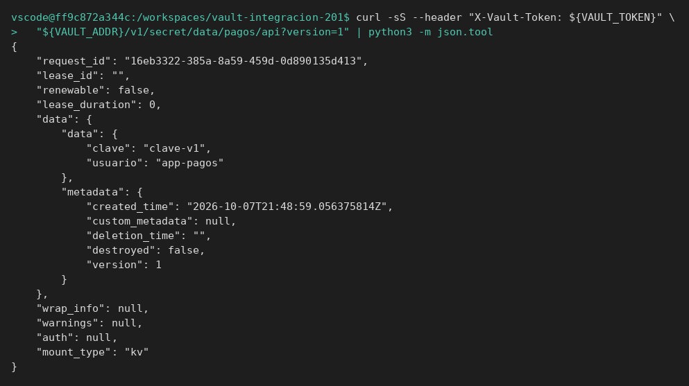
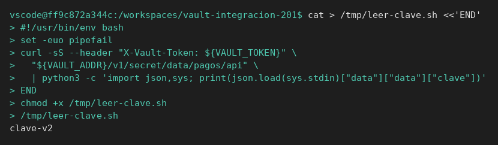
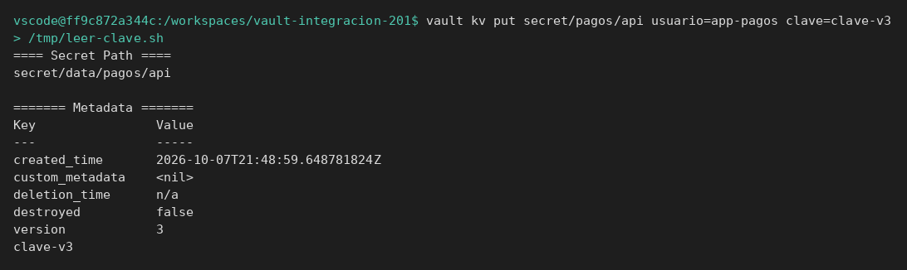
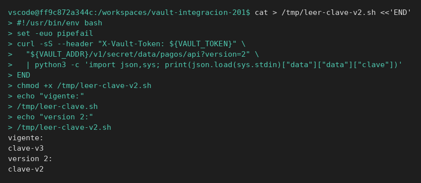

# Versiones y API

[← Página anterior](00-cli-api-y-kv.md) · [Siguiente página →](02-lab-borrar-version.md)

Vas a guardar dos versiones, leerlas por HTTP y dejar un script que imprime solo la clave vigente. El script es el embrión de la aplicación que probarás después.

### Objetivo

Tener `secret/pagos/api` en versión 2 y un script `leer-clave.sh` que escribe por pantalla la clave de la última versión.

### Punto de partida

```bash
bash infra/reiniciar-vault.sh
source infra/entorno.sh
cd "$(git rev-parse --show-toplevel 2>/dev/null || pwd)"
```

Servidor vacío. Trabaja en la raíz del repo para que el script quede en `/tmp`, no dependas de otra página.

### En qué consiste

Escritura de v1 y v2, lectura selectiva, `curl` de la última y de la versión 1, y un script que repite esa lectura.

### 1 — Crea la versión 1

**Acción:**

```bash
vault kv put secret/pagos/api usuario=app-pagos clave=clave-v1
```

**Por qué:** hace falta un valor conocido para poder demostrar luego que no se ha perdido.

**Resultado esperado:** `version` es `1`.


### 2 — Crea la versión 2

**Acción:**

```bash
vault kv put secret/pagos/api usuario=app-pagos clave=clave-v2
```

**Por qué:** una rotación, en KV v2, es otra escritura del mismo camino. El test tiene que decir si espera la nueva o si alguien se quedó en la anterior.

**Resultado esperado:** `version` es `2`.



### 3 — Lee la última y la anterior

**Acción:**

```bash
vault kv get -field=clave secret/pagos/api; echo
vault kv get -field=clave -version=1 secret/pagos/api; echo
```

**Por qué:** son las dos respuestas posibles de la aplicación según pida o no versión. Las dos son correctas; el fallo es no saber cuál estás afirmando. El `; echo` hace falta porque `-field` no imprime salto de línea: sin él, `clave-v2` y `clave-v1` salen pegados.

**Resultado esperado:** la primera línea es `clave-v2`. La segunda es `clave-v1`.



### 4 — Mira la ficha, no solo el valor

**Acción:**

```bash
vault kv metadata get secret/pagos/api
```

**Por qué:** si el valor «parece bien» pero la versión no es la que desplegaron, el fallo está aquí. `current_version` es lo que recibe quien no pide versión.

**Resultado esperado:** `current_version` es `2`. Hay dos versiones en la lista.



### 5 — Lee la última por API

**Acción:**

```bash
curl -sS --header "X-Vault-Token: ${VAULT_TOKEN}" \
  "${VAULT_ADDR}/v1/secret/data/pagos/api" | python3 -m json.tool
```

**Por qué:** este JSON es el contrato. `data.data.clave` es el secreto. `data.metadata.version` es la versión.

**Resultado esperado:** `clave` igual a `clave-v2` y `version` igual a `2`.



### 6 — Lee la versión 1 por API

**Acción:**

```bash
curl -sS --header "X-Vault-Token: ${VAULT_TOKEN}" \
  "${VAULT_ADDR}/v1/secret/data/pagos/api?version=1" | python3 -m json.tool
```

**Por qué:** una prueba de regresión que fija la versión usa esta query. Sin `?version=1` estarías releyendo la última y el caso no demuestra nada.

**Resultado esperado:** `clave` igual a `clave-v1` y `version` igual a `1`.



### 7 — Deja un script que solo imprime la clave vigente

**Acción:**

```bash
cat > /tmp/leer-clave.sh <<'EOF'
#!/usr/bin/env bash
set -euo pipefail
curl -sS --header "X-Vault-Token: ${VAULT_TOKEN}" \
  "${VAULT_ADDR}/v1/secret/data/pagos/api" \
  | python3 -c 'import json,sys; print(json.load(sys.stdin)["data"]["data"]["clave"])'
EOF
chmod +x /tmp/leer-clave.sh
/tmp/leer-clave.sh
```

**Por qué:** la aplicación no enseña el JSON al operador. Entrega la cadena. El script usa el token del entorno, igual que un proceso al que le inyectan `VAULT_TOKEN`.

**Resultado esperado:** el script imprime una sola línea, `clave-v2`.



> [!TIP]
> Si el script dice que no existe `VAULT_TOKEN`, esta terminal no ha cargado el entorno. `source infra/entorno.sh` y vuelve a lanzarlo. No reescribas el script.

## Comprueba tu entendimiento

**Rotación**
`vault kv put secret/pagos/api usuario=app-pagos clave=clave-v3` y después `/tmp/leer-clave.sh`
→ El script imprime `clave-v3` sin modificarlo. Lee siempre la última versión.



## Reto

### 1 — Fijar la versión 2 desde el script

Copia la idea de `/tmp/leer-clave.sh` a `/tmp/leer-clave-v2.sh` para que pida `?version=2`. Después escribe una versión 3 y comprueba que el script nuevo sigue imprimiendo `clave-v2`.

<details>
<summary>Ver solución</summary>

En el `curl`, la URL termina en `secret/data/pagos/api?version=2`.

```bash
vault kv put secret/pagos/api usuario=app-pagos clave=clave-v3
/tmp/leer-clave-v2.sh
```

Imprime `clave-v2`. `/tmp/leer-clave.sh` imprimiría `clave-v3`.



</details>

## Errores frecuentes

| Síntoma | Causa probable | Cómo arreglarlo |
|---------|----------------|-----------------|
| `No value found` | El reinicio borró la memoria y no has vuelto a hacer el `kv put` | Repite los pasos 1 y 2 en este servidor |
| El script imprime el JSON entero o peta en python | La URL no es la de KV v2 | Tiene que ser `/v1/secret/data/pagos/api` |
| `version` no es 2 | Has leído `?version=1` o no llegaste a la segunda escritura | `vault kv metadata get secret/pagos/api` y mira `current_version` |
