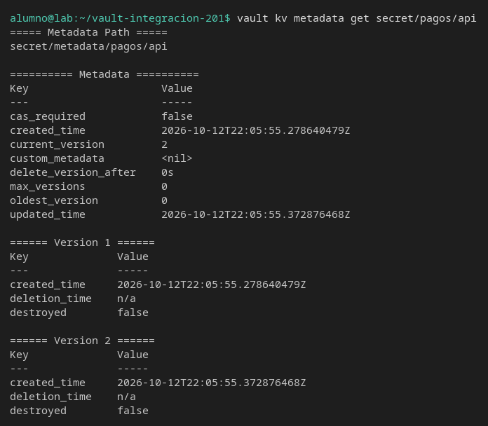
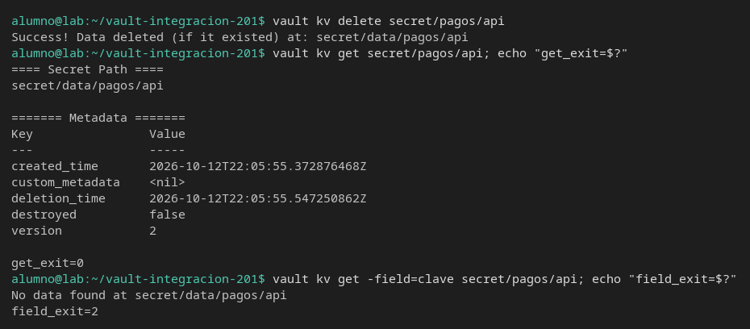
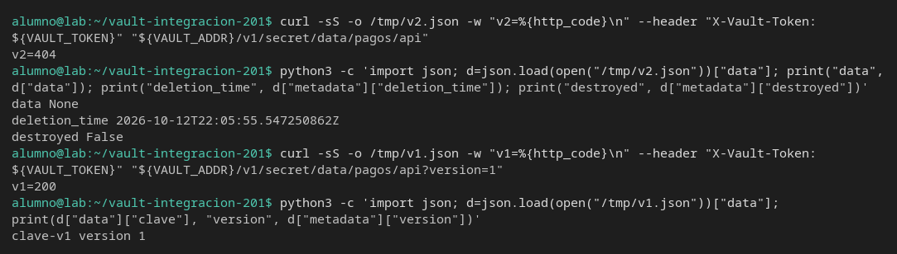
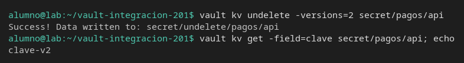
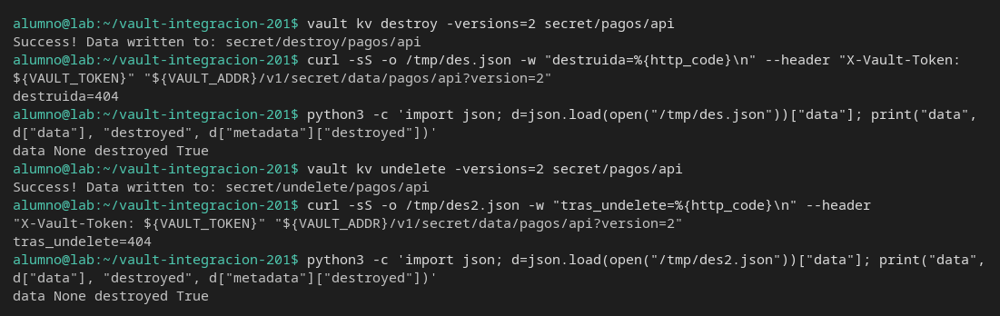

# Borrar una versión

[← Página anterior](01-lab-versiones-y-api.md) · [Siguiente página →](03-lab-listar-y-variables.md)

Borrar la versión vigente no es lo mismo que no haber escrito nunca el secreto, ni lo mismo que destruirla. Vas a provocar las tres lecturas y mirar el cuerpo, no solo el código de salida del CLI.

### Objetivo

Dejar la versión 2 de `secret/pagos/api` borrada y recuperada, y después destruida de forma que `undelete` ya no la devuelva.

### Punto de partida

```bash
bash infra/reiniciar-vault.sh
source infra/entorno.sh
```

Servidor vacío. Trabaja en `secret/pagos/api`. No hace falta el script de la página anterior.

### En qué consiste

Dos escrituras, borrado de la última versión, lectura de la versión 1, recuperación, destrucción y un `undelete` que ya no restaura el valor.

### 1 — Crea la versión 1 y la 2

**Acción:**

```bash
vault kv put secret/pagos/api clave=clave-v1
vault kv put secret/pagos/api clave=clave-v2
```

**Por qué:** hace falta una versión vieja que siga siendo legible cuando borres la nueva. Si solo hay una, no se distingue «borrada» de «nunca existió».

**Resultado esperado:** la segunda escritura dice `version` `2`.

### 2 — Mira la metadata

**Acción:**

```bash
vault kv metadata get secret/pagos/api
```

**Por qué:** la metadata es el sitio donde un test ve `current_version`, `deletion_time` y `destroyed` sin depender de que el CLI imprima el valor.

**Resultado esperado:** `current_version` es `2`. En la versión 2, `destroyed` es `false` y `deletion_time` es `n/a`.



### 3 — Borra la versión vigente

**Acción:**

```bash
vault kv delete secret/pagos/api
vault kv get secret/pagos/api; echo "get_exit=$?"
vault kv get -field=clave secret/pagos/api; echo "field_exit=$?"
```

**Por qué:** `vault kv delete` sin `-versions` marca la última versión como borrada. `vault kv get` sin `-field` puede terminar en 0 y no enseñar `Data`. Un script que solo mire el código de salida dirá que la lectura ha ido bien.

**Resultado esperado:** `Success! Data deleted`. El `get` muestra `deletion_time` con una fecha y `version` `2`, sin bloque `Data`. `get_exit=0`. El `-field` imprime `No data found at secret/data/pagos/api` y `field_exit=2`.



> [!WARNING]
> `get_exit=0` no significa que la clave esté. Si tu comprobación no pide el campo, este caso se cuela como éxito.

### 4 — Lee por HTTP la vigente y la versión 1

**Acción:**

```bash
curl -sS -o /tmp/v2.json -w "v2=%{http_code}\n" \
  --header "X-Vault-Token: ${VAULT_TOKEN}" \
  "${VAULT_ADDR}/v1/secret/data/pagos/api"
python3 -c 'import json; d=json.load(open("/tmp/v2.json"))["data"]; print("data", d["data"]); print("deletion_time", d["metadata"]["deletion_time"]); print("destroyed", d["metadata"]["destroyed"])'
curl -sS -o /tmp/v1.json -w "v1=%{http_code}\n" \
  --header "X-Vault-Token: ${VAULT_TOKEN}" \
  "${VAULT_ADDR}/v1/secret/data/pagos/api?version=1"
python3 -c 'import json; d=json.load(open("/tmp/v1.json"))["data"]; print(d["data"]["clave"], "version", d["metadata"]["version"])'
```

**Por qué:** la API de la versión vigente responde 404 con `data` a null y `deletion_time` relleno. `destroyed` sigue en false: se puede recuperar. La versión 1 no se ha tocado.

**Resultado esperado:** `v2=404`, `data None`, `deletion_time` con una fecha, `destroyed False`. `v1=200` y `clave-v1`.



### 5 — Recupera la versión 2

**Acción:**

```bash
vault kv undelete -versions=2 secret/pagos/api
vault kv get -field=clave secret/pagos/api; echo
```

**Por qué:** un borrado blando es reversible. El test de «la rotación desapareció» tiene que decir si espera undelete o si el dato tenía que seguir oculto.

**Resultado esperado:** `Success! Data written to: secret/undelete/pagos/api`. La lectura imprime `clave-v2`.



### 6 — Destruye la versión 2 y comprueba que no vuelve

**Acción:**

```bash
vault kv destroy -versions=2 secret/pagos/api
curl -sS -o /tmp/des.json -w "destruida=%{http_code}\n" \
  --header "X-Vault-Token: ${VAULT_TOKEN}" \
  "${VAULT_ADDR}/v1/secret/data/pagos/api?version=2"
python3 -c 'import json; d=json.load(open("/tmp/des.json"))["data"]; print("data", d["data"], "destroyed", d["metadata"]["destroyed"])'
vault kv undelete -versions=2 secret/pagos/api
curl -sS -o /tmp/des2.json -w "tras_undelete=%{http_code}\n" \
  --header "X-Vault-Token: ${VAULT_TOKEN}" \
  "${VAULT_ADDR}/v1/secret/data/pagos/api?version=2"
python3 -c 'import json; d=json.load(open("/tmp/des2.json"))["data"]; print("data", d["data"], "destroyed", d["metadata"]["destroyed"])'
```

**Por qué:** `destroy` borra el valor para siempre. `undelete` imprime `Success` igualmente, y el dato no vuelve. La afirmación del test es `destroyed: true` y `data` null, no la palabra Success del CLI.

**Resultado esperado:** las dos lecturas son HTTP 404, `data None` y `destroyed True`. La versión 1, si la pides con `?version=1`, sigue siendo `clave-v1`.



## Comprueba tu entendimiento

**La versión 1 después de destruir la 2**
`curl -sS --header "X-Vault-Token: ${VAULT_TOKEN}" "${VAULT_ADDR}/v1/secret/data/pagos/api?version=1" | python3 -c 'import json,sys; print(json.load(sys.stdin)["data"]["data"]["clave"])'`
→ Imprime `clave-v1`. Destruir la 2 no toca la 1.

## Reto

### 1 — Borrar solo la versión 1

Con el servidor como está (versión 2 destruida), la versión vigente útil es la 1 si la vuelves a dejar como última escritura. Más simple: crea de nuevo `clave=clave-v3` (será la versión 3), borra solo la 1 con `-versions=1` y lee la última y la 1.

<details>
<summary>Ver solución</summary>

```bash
vault kv put secret/pagos/api clave=clave-v3
vault kv delete -versions=1 secret/pagos/api
vault kv get -field=clave secret/pagos/api; echo
curl -sS -o /tmp/solo1.json -w "v1=%{http_code}\n" \
  --header "X-Vault-Token: ${VAULT_TOKEN}" \
  "${VAULT_ADDR}/v1/secret/data/pagos/api?version=1"
python3 -c 'import json; print(json.load(open("/tmp/solo1.json"))["data"]["data"])'
```

La última lectura imprime `clave-v3`. `v1=404` y `data` es `None`: has borrado una versión que no era la vigente.

</details>

## Errores frecuentes

| Síntoma | Causa probable | Cómo arreglarlo |
|---------|----------------|-----------------|
| `vault kv get` sale 0 y crees que hay clave | La versión vigente está borrada; sin `-field` no hay bloque `Data` | Usa `-field=clave` o mira `deletion_time` |
| `undelete` dice Success y el valor no vuelve | Esa versión está `destroyed` | `destroy` no se deshace. Escribe una versión nueva con `vault kv put` |
| La versión 1 también es 404 | Borraste sin `-versions` varias veces o destruiste la 1 | `vault kv metadata get secret/pagos/api` y mira cada versión |
