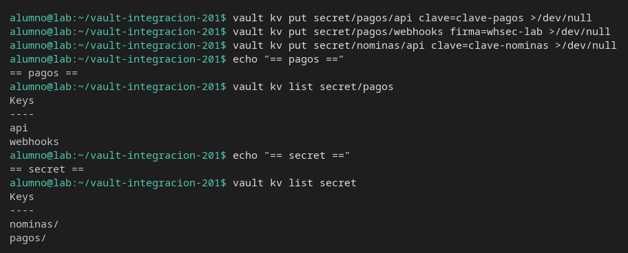
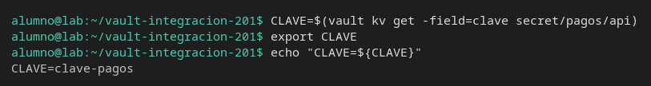
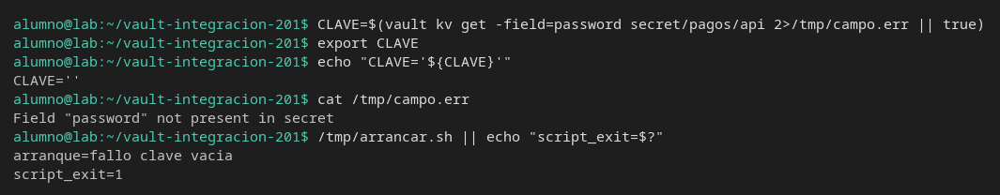

# Listar y variables

[← Página anterior](02-lab-borrar-version.md) · [Siguiente página →](../M03-policies-y-tokens/README.md)

La aplicación no abre el UI de Vault: arranca con una variable. Vas a listar los caminos que existen y a volcar un solo campo a `CLAVE`, y a ver qué pasa cuando el campo no está.

### Objetivo

Tener `CLAVE=clave-pagos` en el entorno y un script `/tmp/arrancar.sh` que sale 1 si esa variable va vacía.

### Punto de partida

```bash
bash infra/reiniciar-vault.sh
source infra/entorno.sh
unset CLAVE
```

Servidor vacío. `unset` evita que una `CLAVE` de otro ejercicio en esta terminal dé un falso éxito.

### En qué consiste

Tres secretos, un listado, la variable y el script de arranque. No hay policies: el token sigue siendo `root`.

### 1 — Crea los tres secretos

**Acción:**

```bash
vault kv put secret/pagos/api clave=clave-pagos
vault kv put secret/pagos/webhooks firma=whsec-lab
vault kv put secret/nominas/api clave=clave-nominas
```

**Por qué:** el listado tiene que poder separar `pagos/` de `nominas/`. Si solo hay un camino, no se ve el corte.

**Resultado esperado:** las tres escrituras dicen `version` `1`.

### 2 — Lista pagos y la raíz del motor

**Acción:**

```bash
echo "== pagos =="
vault kv list secret/pagos
echo "== secret =="
vault kv list secret
```

**Por qué:** `list` no devuelve valores. Devuelve nombres. Una prueba de «¿existe el camino?» usa esto, no un `get` que falle por otro motivo. Las carpetas salen con barra final.

**Resultado esperado:** bajo `secret/pagos` están `api` y `webhooks`. Bajo `secret` están `nominas/` y `pagos/`. No se imprime `clave-pagos`.



### 3 — Vuelca el campo a una variable

**Acción:**

```bash
CLAVE=$(vault kv get -field=clave secret/pagos/api)
export CLAVE
echo "CLAVE=${CLAVE}"
```

**Por qué:** esto es lo que haría el arranque antes de ejecutar la aplicación: una variable, no el JSON entero. El `export` la deja visible para el script del paso siguiente.

**Resultado esperado:** `CLAVE=clave-pagos`.



### 4 — Escribe el script que se niega a arrancar en vacío

**Acción:**

```bash
cat > /tmp/arrancar.sh <<'EOF'
#!/usr/bin/env bash
set -euo pipefail
if [[ -z "${CLAVE:-}" ]]; then
  echo "arranque=fallo clave vacia"
  exit 1
fi
echo "arranque=ok"
EOF
chmod +x /tmp/arrancar.sh
/tmp/arrancar.sh
```

**Por qué:** el test del arranque no es «Vault respondió». Es «la variable que la aplicación va a usar tiene valor». El script no llama a Vault: si `CLAVE` se pierde, el fallo es del entorno.

**Resultado esperado:** `arranque=ok`.

### 5 — Prueba el campo que no existe

**Acción:**

```bash
CLAVE=$(vault kv get -field=password secret/pagos/api 2>/tmp/campo.err || true)
export CLAVE
echo "CLAVE='${CLAVE}'"
cat /tmp/campo.err
/tmp/arrancar.sh || echo "script_exit=$?"
```

**Por qué:** el secreto existe y el campo no. `CLAVE` queda vacía y el script sale 1. No es un 404 del camino `secret/pagos/api`.

**Resultado esperado:** `CLAVE=''`, el fichero de error dice `Field "password" not present in secret`, y `arranque=fallo clave vacia` con `script_exit=1`.



## Comprueba tu entendimiento

**Listar una carpeta que no existe**
`vault kv list secret/no-hay`
→ El comando falla con `No value found at secret/metadata/no-hay`. No lista `pagos` ni `nominas`.

## Reto

### 1 — La firma del webhook

Exporta `FIRMA` con el campo `firma` de `secret/pagos/webhooks` y lista solo `secret/nominas`.

<details>
<summary>Ver solución</summary>

```bash
FIRMA=$(vault kv get -field=firma secret/pagos/webhooks)
export FIRMA
echo "FIRMA=${FIRMA}"
vault kv list secret/nominas
```

`FIRMA=whsec-lab`. El listado de nóminas muestra `api` y no muestra `webhooks`.

</details>

## Errores frecuentes

| Síntoma | Causa probable | Cómo arreglarlo |
|---------|----------------|-----------------|
| `arranque=ok` con el campo mal | `CLAVE` sigue exportada del paso 3 | Repite la asignación del paso 5. `echo "CLAVE='${CLAVE}'"` tiene que salir vacío |
| `CLAVE` vacía en otra terminal | `export` vale solo para esta shell | Vuelve a calcularla o haz `source` del entorno y el `export` |
| `vault kv list secret/pagos` no enseña valores | Es el comportamiento de list | El valor se lee con `vault kv get` |
