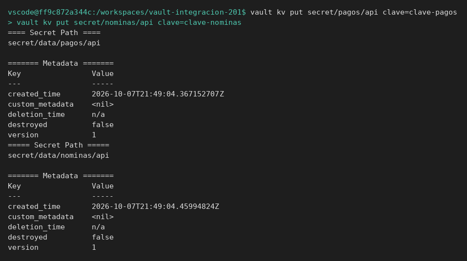
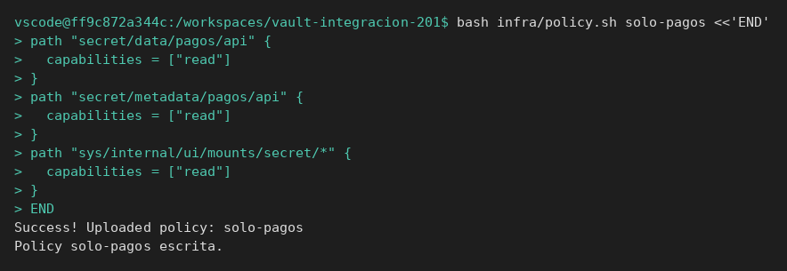
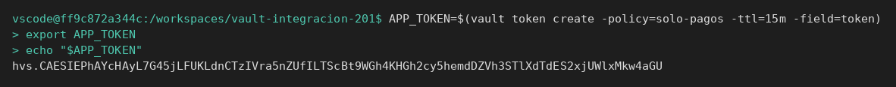
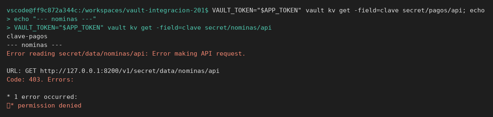

# Policies, tokens y auditoría

[← Página anterior](README.md) · [Siguiente página →](01-lab-permisos-y-ttl.md)

Un 403 de Vault, con el servicio en pie, es una policy o un token. Esta página lo enseña con un token que no es `root`. El servidor se crea aquí.

## Punto de partida

```bash
bash infra/reiniciar-vault.sh
source infra/entorno.sh
```

El token de esta terminal sigue siendo `root`, y hace falta para crear la policy. El token que luego lee es otro.

## Recorrido

1. Hay un secreto de pagos y otro de nóminas. La aplicación de pagos no debería poder leer el segundo. Si la prueba usa `root`, los dos funcionan y el control no existe.

```bash
vault kv put secret/pagos/api clave=clave-pagos
vault kv put secret/nominas/api clave=clave-nominas
```

Las dos escrituras responden `version` `1`.



2. La policy `solo-pagos` solo tiene `read` sobre `secret/data/pagos/api`. No lista, no escribe, no entra en nóminas.

```bash
bash infra/policy.sh solo-pagos <<'EOF'
path "secret/data/pagos/api" {
  capabilities = ["read"]
}
path "secret/metadata/pagos/api" {
  capabilities = ["read"]
}
path "sys/internal/ui/mounts/secret/*" {
  capabilities = ["read"]
}
EOF
```

La orden termina en `Policy solo-pagos escrita.`



3. El token nuevo lleva esa policy y un TTL de 15 minutos. A partir de aquí las lecturas de comprobación usan `VAULT_TOKEN` con ese valor, no `root`.

```bash
APP_TOKEN=$(vault token create -policy=solo-pagos -ttl=15m -field=token)
export APP_TOKEN
echo "$APP_TOKEN"
```

La salida es una sola cadena `hvs.`. Ese es el token de la aplicación. No es la palabra `root`.



4. Con ese token, la lectura de pagos devuelve `clave-pagos`. La lectura de nóminas termina en error 403 y el texto incluye `permission denied`. Vault está sano: la policy ha hecho su trabajo.

```bash
APP_TOKEN=$(vault token create -policy=solo-pagos -ttl=15m -field=token)
export APP_TOKEN
VAULT_TOKEN="$APP_TOKEN" vault kv get -field=clave secret/pagos/api; echo
echo "--- nominas ---"
VAULT_TOKEN="$APP_TOKEN" vault kv get -field=clave secret/nominas/api
```

La primera línea es `clave-pagos`. La de nóminas es `Code: 403` y `permission denied`.



5. El dispositivo de auditoría escribe una línea JSON por petición. El valor del secreto no va en claro. Cuando la aplicación diga «Vault ha fallado», este rastro dice si la petición llegó y con qué resultado. El filtro se queda con las respuestas a `secret/data/`: pagos sin error, nóminas con `permission denied`.

```bash
docker exec -e VAULT_ADDR=http://127.0.0.1:8200 -e VAULT_TOKEN=root \
  vault-dev vault audit enable file file_path=/tmp/vault-audit.log
VAULT_TOKEN="$APP_TOKEN" vault kv get -field=clave secret/pagos/api; echo
VAULT_TOKEN="$APP_TOKEN" vault kv get secret/nominas/api || true
docker exec vault-dev cat /tmp/vault-audit.log | python3 -c '
import json, sys
raw = sys.stdin.read()
print("clave-pagos en el fichero:", "clave-pagos" in raw)
seen = set()
for line in raw.splitlines():
    if not line.strip():
        continue
    obj = json.loads(line)
    path = (obj.get("request") or {}).get("path") or ""
    if obj.get("type") != "response" or "secret/data/" not in path:
        continue
    key = (path, obj.get("error"))
    if key in seen:
        continue
    seen.add(key)
    print("path=%s error=%s" % (path, obj.get("error")))
'
```

`clave-pagos en el fichero` es `False`. Hay una línea de `secret/data/pagos/api` con `error=None` y otra de `secret/data/nominas/api` con `permission denied`.


## Qué queda visto

Hace falta un token distinto de `root` para probar autorización. El [laboratorio](01-lab-permisos-y-ttl.md) crea de nuevo policy, secreto y token.
