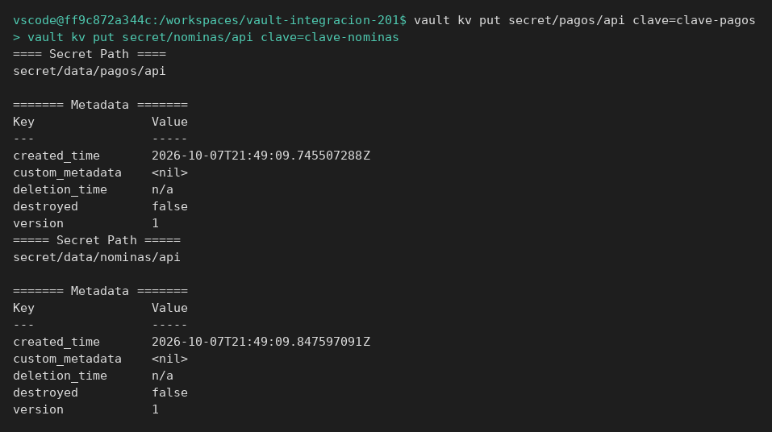
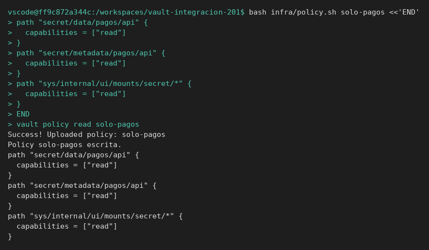
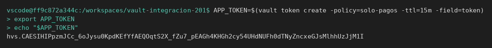
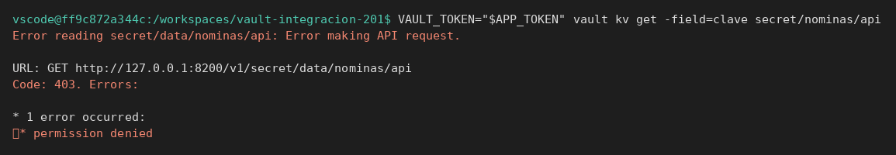
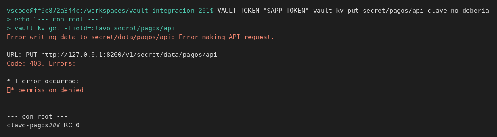
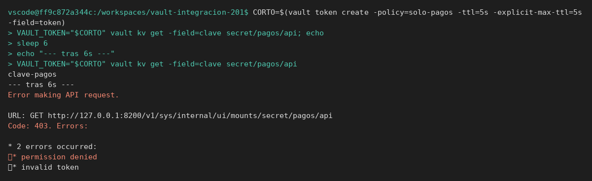
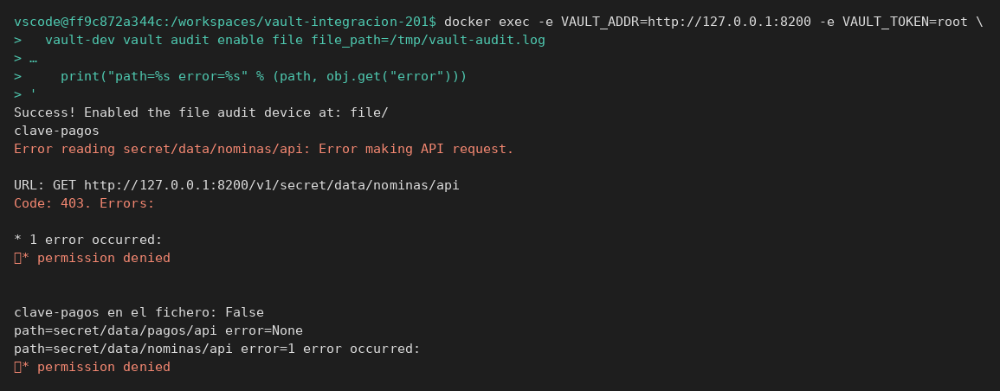
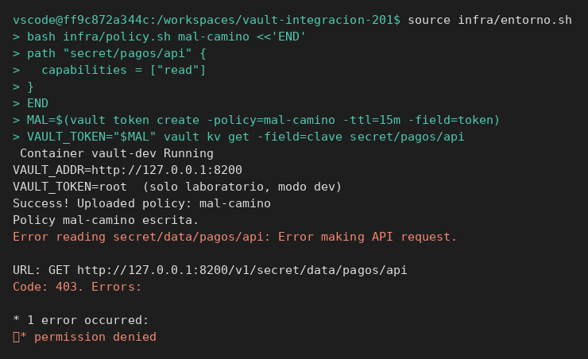
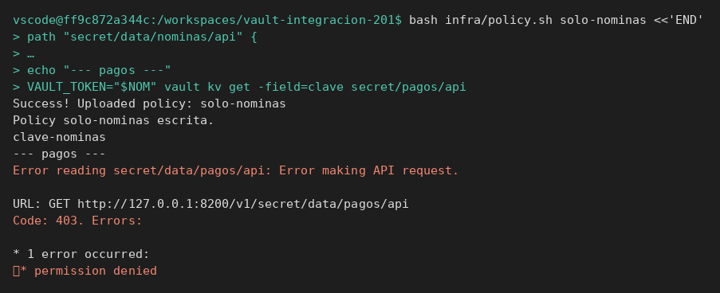

# Permisos y TTL

[← Página anterior](00-policies-tokens-auditoria.md) · [Siguiente página →](02-lab-renovar-token.md)

Vas a emitir el token con el que se probaría la aplicación de pagos, ver el 403 del camino prohibido, dejar el token caducar y encontrar la petición en la auditoría.

### Objetivo

Un token que lee `secret/pagos/api`, recibe 403 en `secret/nominas/api`, y deja de valer a los pocos segundos cuando el TTL es corto.

### Punto de partida

```bash
bash infra/reiniciar-vault.sh
source infra/entorno.sh
```

Servidor vacío. `VAULT_TOKEN` es `root` hasta que el paso 4 lo cambie en una variable aparte. No hace falta el módulo 2: el secreto se crea aquí.

### En qué consiste

Dos secretos, una policy de lectura, un token de 15 minutos, un token de 5 segundos y un dispositivo de auditoría en fichero dentro del contenedor.

### 1 — Crea los dos secretos

**Acción:**

```bash
vault kv put secret/pagos/api clave=clave-pagos
vault kv put secret/nominas/api clave=clave-nominas
```

**Por qué:** el permitido y el prohibido tienen que existir. Si el prohibido no existe, un 404 se confunde con un 403.

**Resultado esperado:** las dos escrituras responden `version` `1`.



### 2 — Escribe la policy

**Acción:**

```bash
bash infra/policy.sh solo-pagos <<'EOF'
path "secret/data/pagos/api" {
  capabilities = ["read"]
}
path "secret/metadata/pagos/api" {
  capabilities = ["read"]
}
path "sys/internal/ui/mounts/secret/*" {
  capabilities = ["read"]
}
EOF
vault policy read solo-pagos
```

**Por qué:** el camino del valor es `secret/data/...` porque KV v2 lee por ahí. `sys/internal/ui/mounts/secret/*` lo pide el CLI antes de leer: sin eso, el 403 es del preflight y no del secreto. Una policy solo sobre `secret/pagos/api` no concede la lectura.

**Resultado esperado:** `policy read` imprime el bloque con `capabilities = ["read"]` y el path `secret/data/pagos/api`.



### 3 — Emite el token de la aplicación

**Acción:**

```bash
APP_TOKEN=$(vault token create -policy=solo-pagos -ttl=15m -field=token)
export APP_TOKEN
echo "$APP_TOKEN"
```

**Por qué:** este token es el que pondrías en la aplicación. `root` se queda en `VAULT_TOKEN` para seguir administrando.

**Resultado esperado:** `APP_TOKEN` es una cadena no vacía. No es la palabra `root`.



### 4 — Lee el secreto permitido

**Acción:**

```bash
VAULT_TOKEN="$APP_TOKEN" vault kv get -field=clave secret/pagos/api
```

**Por qué:** la variable de entorno de esta orden sustituye a `root` solo aquí. Así se ve lo que ve la aplicación.

**Resultado esperado:** `clave-pagos`.


### 5 — Lee el secreto prohibido

**Acción:**

```bash
VAULT_TOKEN="$APP_TOKEN" vault kv get -field=clave secret/nominas/api
```

**Por qué:** este es el caso de prueba «permisos insuficientes». El servicio responde. La policy niega el camino.

**Resultado esperado:** el comando termina con error. El mensaje lleva `permission denied` y el código es 403. No aparece `clave-nominas`.



> [!NOTE]
> El shell puede mostrar el código de salida 2. Lo que anotas en el informe es el 403 de Vault, no el número del shell.

### 6 — Intenta escribir con el mismo token

**Acción:**

```bash
VAULT_TOKEN="$APP_TOKEN" vault kv put secret/pagos/api clave=no-deberia
echo "--- con root ---"
vault kv get -field=clave secret/pagos/api
```

**Por qué:** la policy es solo `read`. Un test de «la app no puede rotar el secreto» es esta escritura.

**Resultado esperado:** error `permission denied`. Con `root` (`vault kv get -field=clave secret/pagos/api`) la clave sigue siendo `clave-pagos`.



### 7 — Deja un token caducar

**Acción:**

```bash
CORTO=$(vault token create -policy=solo-pagos -ttl=5s -explicit-max-ttl=5s -field=token)
VAULT_TOKEN="$CORTO" vault kv get -field=clave secret/pagos/api; echo
sleep 6
echo "--- tras 6s ---"
VAULT_TOKEN="$CORTO" vault kv get -field=clave secret/pagos/api
```

**Por qué:** un token válido y el mismo token segundos después no son el mismo caso. El segundo es «token expirado». Si no esperas, no has probado la caducidad. El `; echo` separa la clave del texto que viene después, porque `-field` no imprime salto de línea.

**Resultado esperado:** la primera lectura imprime `clave-pagos`. La segunda, después de `sleep 6`, falla con 403. El texto lleva `invalid token`. La URL puede ser el preflight `sys/internal/ui/mounts/...`: Vault ni siquiera llega al secreto. No imprime la clave.



### 8 — Activa auditoría y repite una lectura permitida y otra no

**Acción:**

```bash
docker exec -e VAULT_ADDR=http://127.0.0.1:8200 -e VAULT_TOKEN=root \
  vault-dev vault audit enable file file_path=/tmp/vault-audit.log
VAULT_TOKEN="$APP_TOKEN" vault kv get -field=clave secret/pagos/api; echo
VAULT_TOKEN="$APP_TOKEN" vault kv get secret/nominas/api || true
docker exec vault-dev cat /tmp/vault-audit.log | python3 -c '
import json, sys
raw = sys.stdin.read()
print("clave-pagos en el fichero:", "clave-pagos" in raw)
seen = set()
for line in raw.splitlines():
    if not line.strip():
        continue
    obj = json.loads(line)
    path = (obj.get("request") or {}).get("path") or ""
    if obj.get("type") != "response" or "secret/data/" not in path:
        continue
    key = (path, obj.get("error"))
    if key in seen:
        continue
    seen.add(key)
    print("path=%s error=%s" % (path, obj.get("error")))
'
```

**Por qué:** el log de la aplicación no basta. Cada petición son varias líneas JSON (preflight y lectura, petición y respuesta). El filtro deja solo la respuesta de `secret/data/`. El valor del secreto no va en claro en ese fichero.

**Resultado esperado:** `clave-pagos en el fichero: False`. Una línea `path=secret/data/pagos/api error=None`. Otra `path=secret/data/nominas/api` con `permission denied`.



## Comprueba tu entendimiento

**Policy en el camino equivocado**
Vuelve a `VAULT_TOKEN=root` con `source infra/entorno.sh`. Escribe una policy `mal-camino` sobre `secret/pagos/api` (sin `data`), emite un token y lee con `vault kv get`.
→ 403, aunque el secreto existe. El path de la policy tiene que ser `secret/data/pagos/api`.



## Reto

### 1 — Token que solo lee nóminas

Crea la policy `solo-nominas` sobre `secret/data/nominas/api`, emite un token y comprueba las dos lecturas.

<details>
<summary>Ver solución</summary>

```bash
bash infra/policy.sh solo-nominas <<'EOF'
path "secret/data/nominas/api" {
  capabilities = ["read"]
}
path "secret/metadata/nominas/api" {
  capabilities = ["read"]
}
path "sys/internal/ui/mounts/secret/*" {
  capabilities = ["read"]
}
EOF
NOM=$(vault token create -policy=solo-nominas -ttl=15m -field=token)
VAULT_TOKEN="$NOM" vault kv get -field=clave secret/nominas/api; echo
echo "--- pagos ---"
VAULT_TOKEN="$NOM" vault kv get -field=clave secret/pagos/api
```

La primera imprime `clave-nominas`. La segunda es 403.



</details>

## Errores frecuentes

| Síntoma | Causa probable | Cómo arreglarlo |
|---------|----------------|-----------------|
| También lees nóminas | Estás usando `VAULT_TOKEN=root` | Pon `VAULT_TOKEN="$APP_TOKEN"` delante de la orden |
| 403 también en pagos | La policy no usa `secret/data/...` o el token es el del paso 7, ya caducado | `vault policy read solo-pagos`. Emite otro token de 15m |
| `audit enable` dice que ya existe | Lo activaste en este mismo contenedor | Sigue. Si reinicias Vault, hay que activarlo otra vez |
| El filtro no enseña nada | La ruta está dentro del contenedor, o la auditoría se activó después de las lecturas | El `docker exec vault-dev cat` de arriba. No busques el fichero en tu portátil. Si hace falta, repite las dos lecturas |
