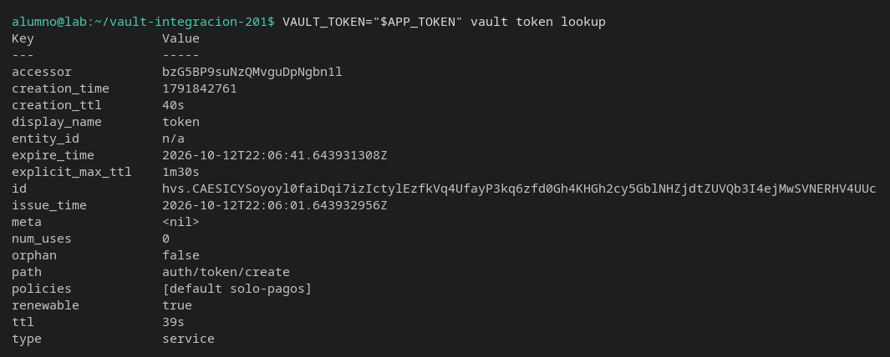
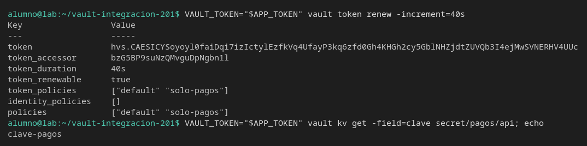
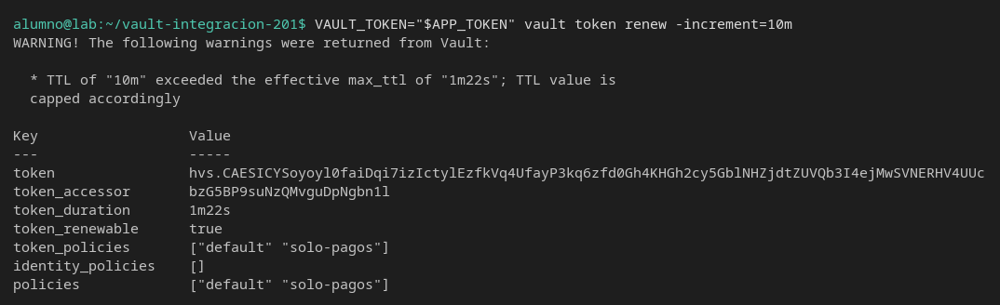

# Renovar el token

[← Página anterior](01-lab-permisos-y-ttl.md) · [Siguiente página →](03-lab-dos-perfiles.md)

Un token que caduca se puede alargar hasta un máximo. Vas a ver el TTL bajar, renovarlo y comprobar que pedir diez minutos no salta ese máximo.

### Objetivo

Un token con policy `solo-pagos`, TTL de 40 segundos y máximo de 90, que tras `vault token renew` sigue pudiendo leer `secret/pagos/api`.

### Punto de partida

```bash
bash infra/reiniciar-vault.sh
source infra/entorno.sh
unset APP_TOKEN
```

Servidor vacío. `VAULT_TOKEN` sigue siendo `root` hasta que un comando lo prefije. `unset` quita un token de otro ejercicio en esta terminal.

### En qué consiste

Policy, token corto, dos lecturas de su TTL, una renovación dentro del máximo y otra que Vault recorta.

### 1 — Secreto, policy y token

**Acción:**

```bash
vault kv put secret/pagos/api clave=clave-pagos
bash infra/policy.sh solo-pagos <<'EOF'
path "secret/data/pagos/api" {
  capabilities = ["read"]
}
path "secret/metadata/pagos/api" {
  capabilities = ["read"]
}
path "sys/internal/ui/mounts/secret/*" {
  capabilities = ["read"]
}
EOF
APP_TOKEN=$(vault token create -policy=solo-pagos -ttl=40s -explicit-max-ttl=90s -field=token)
export APP_TOKEN
echo "token_len=${#APP_TOKEN}"
```

**Por qué:** 40 segundos alcanzan para ver el TTL bajar. El máximo de 90 es el tope que la renovación no puede cruzar. Sin `explicit-max-ttl`, un renew podría alargar el token más de lo que el test cree.

**Resultado esperado:** la policy se escribe. `token_len` es mayor que 20. No hace falta imprimir el token.

### 2 — Mira TTL y policies

**Acción:**

```bash
VAULT_TOKEN="$APP_TOKEN" vault token lookup
```

**Por qué:** el token se consulta a sí mismo. `renewable` tiene que ser `true` para que el paso 4 tenga sentido. En `policies` aparecen `default` y `solo-pagos`: Vault añade `default` aunque no la hayas nombrado. `default` no da acceso a `secret/`.

**Resultado esperado:** `ttl` está cerca de `40s` (un poco menos, el tiempo que tardaste). `renewable` es `true`. `explicit_max_ttl` es `1m30s` (los 90 segundos del `-explicit-max-ttl`). `policies` incluye `default` y `solo-pagos`.



### 3 — Espera y mira otra vez

**Acción:**

```bash
sleep 8
VAULT_TOKEN="$APP_TOKEN" vault token lookup -format=json \
  | python3 -c 'import json,sys; print("ttl", json.load(sys.stdin)["data"]["ttl"])'
```

**Por qué:** si el número no baja, no estás mirando la caducidad. Renovar un TTL que no se mueve no demuestra nada.

**Resultado esperado:** `ttl` es un entero menor que el que viste en el paso 2 (alrededor de 30, según lo que tardes).

### 4 — Renueva dentro del máximo

**Acción:**

```bash
VAULT_TOKEN="$APP_TOKEN" vault token renew -increment=40s
VAULT_TOKEN="$APP_TOKEN" vault kv get -field=clave secret/pagos/api; echo
```

**Por qué:** la aplicación renovaría su propio token, no pediría a `root` que le fabrique otro. Después de renovar, la lectura del secreto tiene que seguir en claro.

**Resultado esperado:** `token_duration` vuelve a estar cerca de `40s`, no cerca de `8s`. La lectura imprime `clave-pagos`.



### 5 — Pide más de lo que el máximo permite

**Acción:**

```bash
VAULT_TOKEN="$APP_TOKEN" vault token renew -increment=10m
```

**Por qué:** el test que afirma «renové diez minutos» está mal si el tope son 90 segundos desde la creación. Vault no falla el comando: avisa y recorta.

**Resultado esperado:** el comando termina bien y escribe un `WARNING` con `exceeded the effective max_ttl` y `capped accordingly`. `token_duration` no es `10m`. Es el tiempo que queda hasta el máximo de 90 segundos.



## Comprueba tu entendimiento

**El token renovado lee el secreto**
`VAULT_TOKEN="$APP_TOKEN" vault kv get -field=clave secret/pagos/api; echo`
→ `clave-pagos`. Renovar no cambia la policy.

## Reto

### 1 — Un token que no se puede renovar

Crea otro token con `-renewable=false` y la misma policy. Intenta `vault token renew`.

<details>
<summary>Ver solución</summary>

```bash
FIJO=$(vault token create -policy=solo-pagos -ttl=10m -renewable=false -field=token)
VAULT_TOKEN="$FIJO" vault token renew -increment=5m || true
```

Responde 400 y el texto `lease is not renewable`. El token del paso 1 no se invalida por este intento.

</details>

## Errores frecuentes

| Síntoma | Causa probable | Cómo arreglarlo |
|---------|----------------|-----------------|
| `permission denied` al hacer lookup | `APP_TOKEN` está vacío | Repite la línea del `vault token create` y el `export` |
| El renew dice `invalid token` | Pasaron más de 90 segundos desde el create | Vuelve al paso 1. El máximo ya se cumplió |
| `token_duration` del paso 5 sí parece largo | Estás leyendo el token `root`, no `APP_TOKEN` | El comando lleva el prefijo `VAULT_TOKEN="$APP_TOKEN"` |
