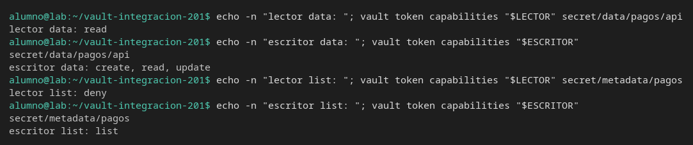
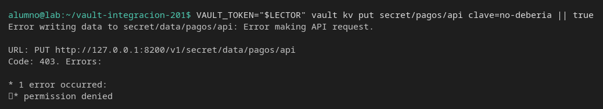
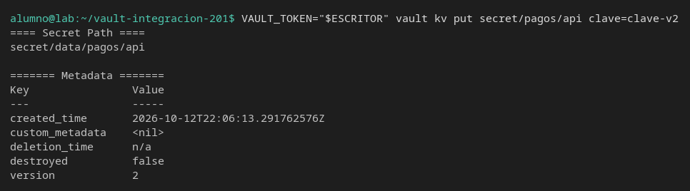
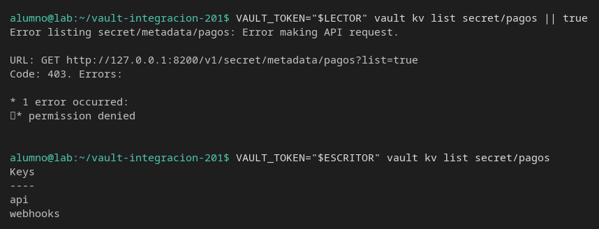

# Dos perfiles

[← Página anterior](02-lab-renovar-token.md) · [Siguiente página →](../M04-autenticacion/README.md)

Leer y escribir no son el mismo permiso, y listar tampoco. Vas a emitir dos tokens y comprobar con `vault token capabilities` lo que cada uno puede hacer antes de lanzar la petición.

### Objetivo

Un token `lector` que recibe 403 al escribir y al listar, y un token `escritor` que crea la versión siguiente de `secret/pagos/api` y lista `secret/pagos`.

### Punto de partida

```bash
bash infra/reiniciar-vault.sh
source infra/entorno.sh
unset LECTOR ESCRITOR
```

Servidor vacío. Los dos tokens se guardan en variables distintas de `VAULT_TOKEN`.

### En qué consiste

Un secreto, dos policies, dos tokens, la tabla de capabilities y tres peticiones: escritura denegada, escritura permitida y listado.

### 1 — El secreto de partida

**Acción:**

```bash
vault kv put secret/pagos/api clave=clave-v1
vault kv put secret/pagos/webhooks firma=whsec-lab
```

**Por qué:** el escritor va a crear la versión 2. Si no hay versión 1, no ves el incremento. El webhook existe para que el listado tenga dos nombres.

**Resultado esperado:** las dos escrituras en `version` `1`.

### 2 — Escribe las dos policies

**Acción:**

```bash
bash infra/policy.sh lector <<'EOF'
path "secret/data/pagos/api" {
  capabilities = ["read"]
}
path "sys/internal/ui/mounts/secret/*" {
  capabilities = ["read"]
}
EOF
bash infra/policy.sh escritor <<'EOF'
path "secret/data/pagos/api" {
  capabilities = ["create", "update", "read"]
}
path "secret/metadata/pagos" {
  capabilities = ["list"]
}
path "sys/internal/ui/mounts/secret/*" {
  capabilities = ["read"]
}
EOF
```

**Por qué:** `lector` puede leer el valor y no puede listar la carpeta: son caminos distintos (`secret/data/...` y `secret/metadata/...`). `escritor` puede crear otra versión y listar `secret/pagos`. Ninguno nombra `secret/nominas`.

**Resultado esperado:** dos líneas `Policy lector escrita.` y `Policy escritor escrita.`

### 3 — Emite los dos tokens

**Acción:**

```bash
LECTOR=$(vault token create -policy=lector -ttl=15m -field=token)
ESCRITOR=$(vault token create -policy=escritor -ttl=15m -field=token)
export LECTOR ESCRITOR
echo "lector_len=${#LECTOR} escritor_len=${#ESCRITOR}"
```

**Por qué:** cada perfil es un token. Probar los dos con `root` no dice nada de la policy.

**Resultado esperado:** las dos longitudes son mayores que 20.

### 4 — Pregunta capabilities antes de llamar

**Acción:**

```bash
echo -n "lector data: "; vault token capabilities "$LECTOR" secret/data/pagos/api
echo -n "escritor data: "; vault token capabilities "$ESCRITOR" secret/data/pagos/api
echo -n "lector list: "; vault token capabilities "$LECTOR" secret/metadata/pagos
echo -n "escritor list: "; vault token capabilities "$ESCRITOR" secret/metadata/pagos
```

**Por qué:** `vault token capabilities` responde con el token `root` qué podría hacer el otro token. Sirve para afirmar el caso antes de ver el 403.

**Resultado esperado:** `lector data: read`. `escritor data: create, read, update`. `lector list: deny`. `escritor list: list`.



### 5 — El lector intenta escribir

**Acción:**

```bash
VAULT_TOKEN="$LECTOR" vault kv put secret/pagos/api clave=no-deberia || true
```

**Por qué:** sabe leer. La prueba de «puede modificar la clave» es otra petición. El 403 tiene que ser del `PUT`, no de un camino que no existe.

**Resultado esperado:** HTTP 403, URL `PUT .../v1/secret/data/pagos/api`, texto `permission denied`.



### 6 — El escritor crea la versión 2

**Acción:**

```bash
VAULT_TOKEN="$ESCRITOR" vault kv put secret/pagos/api clave=clave-v2
```

**Por qué:** la misma URL del paso anterior, otro token. Si este también diera 403, las dos policies estarían mal y el paso 5 no habría probado nada.

**Resultado esperado:** `version` es `2`.



### 7 — Lista con cada token

**Acción:**

```bash
VAULT_TOKEN="$LECTOR" vault kv list secret/pagos || true
VAULT_TOKEN="$ESCRITOR" vault kv list secret/pagos
```

**Por qué:** poder leer `secret/pagos/api` no da derecho a listar la carpeta. Un test de «el directorio contiene api y webhooks» hecho con el token de lectura falla con 403 aunque los secretos existan.

**Resultado esperado:** el lector recibe 403 sobre `GET .../v1/secret/metadata/pagos?list=true`. El escritor imprime `api` y `webhooks`.



## Comprueba tu entendimiento

**La versión que quedó**
`vault kv get -field=clave secret/pagos/api; echo` con el token `root` (haz `source infra/entorno.sh` si hace falta).
→ `clave-v2`. El `put` del lector no llegó a escribir `no-deberia`.

## Reto

### 1 — Qué puede el escritor en nóminas

Crea `secret/nominas/api` con `root` y pregunta `vault token capabilities` del escritor sobre `secret/data/nominas/api`. Intenta leerlo con ese token.

<details>
<summary>Ver solución</summary>

```bash
source infra/entorno.sh
vault kv put secret/nominas/api clave=clave-nominas
echo -n "escritor nominas: "; vault token capabilities "$ESCRITOR" secret/data/nominas/api
VAULT_TOKEN="$ESCRITOR" vault kv get -field=clave secret/nominas/api || true
```

La capability es `deny`. La lectura es 403. `ESCRITOR` sigue definido si no has cerrado la terminal; si sale vacío, repite el paso 3.

</details>

## Errores frecuentes

| Síntoma | Causa probable | Cómo arreglarlo |
|---------|----------------|-----------------|
| El lector también escribe la versión 2 | El `kv put` se lanzó con `root` | Tiene que ir prefijado con `VAULT_TOKEN="$LECTOR"` |
| `capabilities` dice `deny` en los dos | Los tokens se crearon antes de escribir la policy | Repite el paso 3 después del paso 2 |
| El escritor no lista | La policy no tiene `secret/metadata/pagos` con `list` | `vault policy read escritor` |
