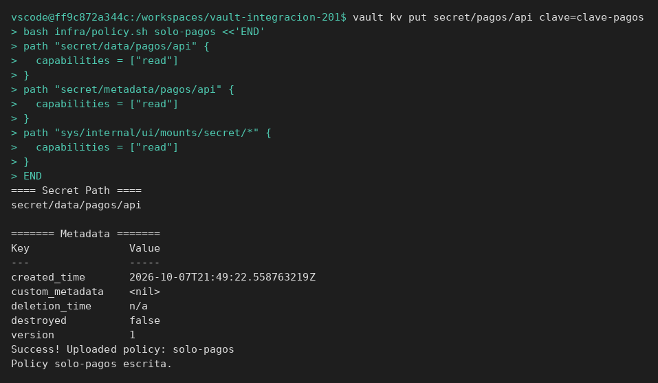
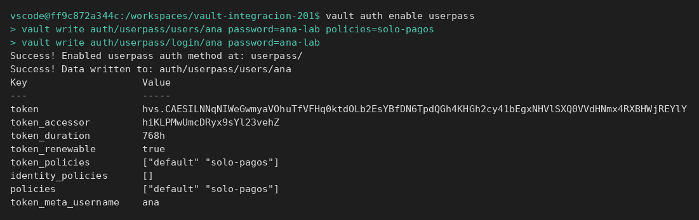
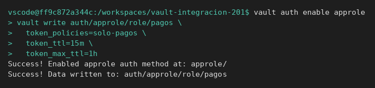

# UserPass y AppRole

[← Página anterior](README.md) · [Siguiente página →](01-lab-approle.md)

Dos entradas distintas acaban en un token con la misma policy. La página crea el servidor, el secreto y la policy. No continúa el módulo 3.

## Punto de partida

```bash
bash infra/reiniciar-vault.sh
source infra/entorno.sh
```

## Recorrido

1. El secreto y la policy quedan listos antes de habilitar ningún login. Sin policy, el método autenticaría a alguien que no puede leer nada, y el fallo se parecería a una contraseña mala.

```bash
vault kv put secret/pagos/api clave=clave-pagos
bash infra/policy.sh solo-pagos <<'EOF'
path "secret/data/pagos/api" {
  capabilities = ["read"]
}
path "secret/metadata/pagos/api" {
  capabilities = ["read"]
}
path "sys/internal/ui/mounts/secret/*" {
  capabilities = ["read"]
}
EOF
```

El secreto queda en versión `1` y la policy se registra sin error.



2. UserPass es el login de una persona. El usuario `ana` tiene contraseña `ana-lab` y la policy `solo-pagos`. El login devuelve un `client_token`. Con ese token se lee la clave. Con la contraseña cambiada, el login falla y no hay token.

```bash
vault auth enable userpass
vault write auth/userpass/users/ana password=ana-lab policies=solo-pagos
vault write auth/userpass/login/ana password=ana-lab
```

En la tabla de la CLI, la clave `token` es el token de Ana (empieza por `hvs.`). `policies` incluye `solo-pagos`. El JSON de la API llama a ese mismo campo `auth.client_token`; el laboratorio de AppRole lo lee así, con `curl`.



3. AppRole es el login de la aplicación. No tiene contraseña de persona. Tiene un `role_id` estable y un `secret_id` que se entrega al despliegue. El login es un POST a `auth/approle/login` con los dos.

```bash
vault auth enable approle
vault write auth/approle/role/pagos \
  token_policies=solo-pagos \
  token_ttl=15m \
  token_max_ttl=1h
```

El rol `pagos` emitirá tokens de 15 minutos con la policy de pagos. Quien no tenga el `secret_id` no entra, aunque conozca el `role_id`.



## Qué queda visto

Persona y aplicación no comparten credencial. El [laboratorio](01-lab-approle.md) vuelve a crear el rol y prueba un `secret_id` inválido.
