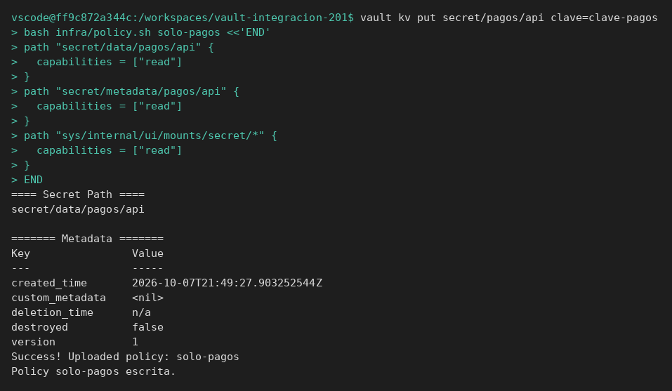
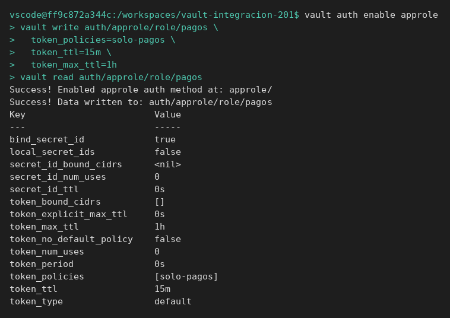
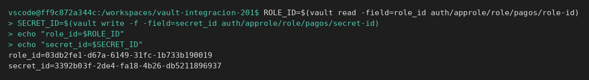
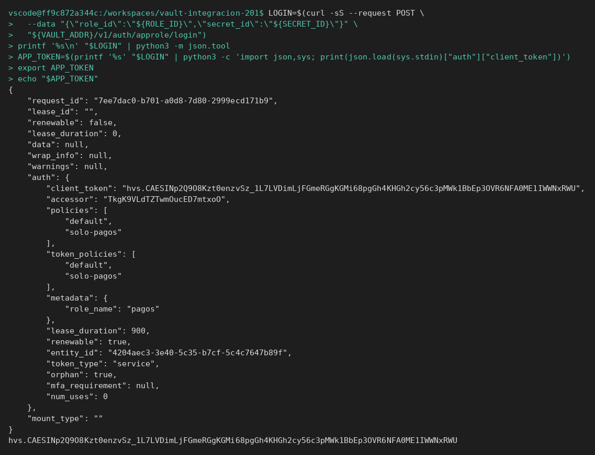
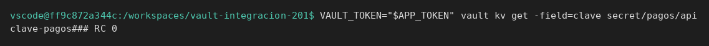
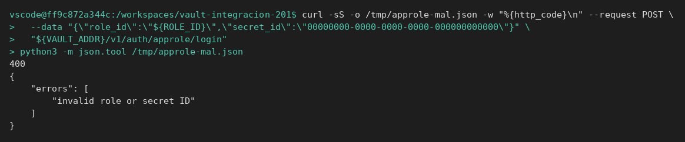
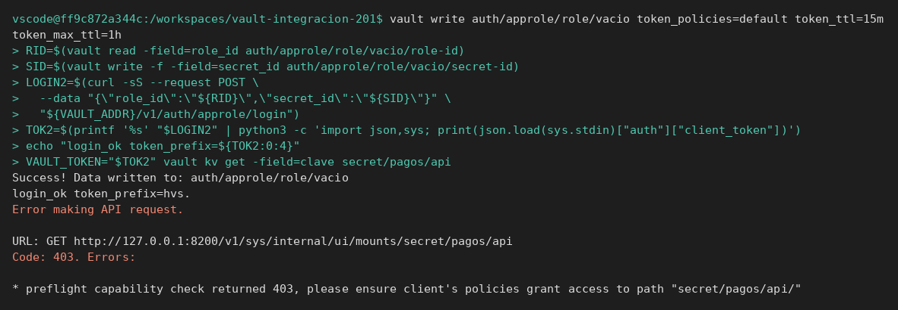
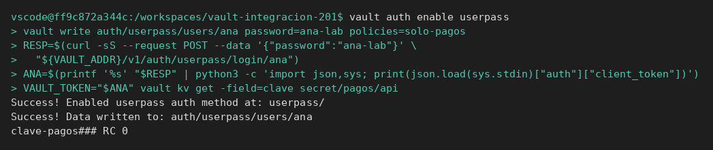

# AppRole

[← Página anterior](00-userpass-y-approle.md) · [Siguiente página →](../M05-integracion-aplicaciones/README.md)

Vas a habilitar AppRole, entrar con `role_id` y `secret_id`, leer el secreto con el token obtenido y comprobar que un `secret_id` falso no entra.

### Objetivo

Obtener un `client_token` por `auth/approle/login` que lea `secret/pagos/api`, y un login fallido con un `secret_id` que no ha emitido Vault.

### Punto de partida

```bash
bash infra/reiniciar-vault.sh
source infra/entorno.sh
```

Servidor vacío. UserPass no hace falta en esta página: el laboratorio es el de la aplicación.

### En qué consiste

Policy, rol AppRole, lectura de los dos identificadores, login por API, uso del token y un identificador inventado.

### 1 — Secreto y policy

**Acción:**

```bash
vault kv put secret/pagos/api clave=clave-pagos
bash infra/policy.sh solo-pagos <<'EOF'
path "secret/data/pagos/api" {
  capabilities = ["read"]
}
path "secret/metadata/pagos/api" {
  capabilities = ["read"]
}
path "sys/internal/ui/mounts/secret/*" {
  capabilities = ["read"]
}
EOF
```

**Por qué:** el rol solo dice qué policy llevará el token. El permiso real está en la policy, y el dato tiene que existir para que la lectura de después demuestre algo.

**Resultado esperado:** `version` `1` en el secreto. La policy queda escrita sin error.



### 2 — Habilita AppRole y crea el rol

**Acción:**

```bash
vault auth enable approle
vault write auth/approle/role/pagos \
  token_policies=solo-pagos \
  token_ttl=15m \
  token_max_ttl=1h
vault read auth/approle/role/pagos
```

**Por qué:** `token_policies` es el permiso. `token_ttl` es la caducidad del token que recibirá la aplicación. No son el secreto de la API.

**Resultado esperado:** `token_policies` contiene `[solo-pagos]` y `token_ttl` es `15m`.



### 3 — Saca role_id y secret_id

**Acción:**

```bash
ROLE_ID=$(vault read -field=role_id auth/approle/role/pagos/role-id)
SECRET_ID=$(vault write -f -field=secret_id auth/approle/role/pagos/secret-id)
echo "role_id=$ROLE_ID"
echo "secret_id=$SECRET_ID"
```

**Por qué:** son las dos piezas que el despliegue inyecta en la aplicación. El `role_id` identifica el rol. El `secret_id` demuestra que ese despliegue está autorizado. Cada `vault write -f` de `secret-id` genera uno nuevo; el anterior puede seguir siendo válido hasta que lo revoques.

**Resultado esperado:** las dos variables tienen valor. No son iguales entre sí. No son la palabra `clave-pagos`.



### 4 — Entra por la API

**Acción:**

```bash
LOGIN=$(curl -sS --request POST \
  --data "{\"role_id\":\"${ROLE_ID}\",\"secret_id\":\"${SECRET_ID}\"}" \
  "${VAULT_ADDR}/v1/auth/approle/login")
printf '%s\n' "$LOGIN" | python3 -m json.tool
APP_TOKEN=$(printf '%s' "$LOGIN" | python3 -c 'import json,sys; print(json.load(sys.stdin)["auth"]["client_token"])')
export APP_TOKEN
echo "$APP_TOKEN"
```

**Por qué:** la aplicación hace este POST. No llama a `vault token create`. Si el test salta al token, no está probando el login.

**Resultado esperado:** el JSON trae `auth.client_token` y `auth.policies` con `solo-pagos`. `APP_TOKEN` es esa cadena.



### 5 — Lee el secreto con el token del login

**Acción:**

```bash
VAULT_TOKEN="$APP_TOKEN" vault kv get -field=clave secret/pagos/api
```

**Por qué:** cierra el circuito: credenciales de AppRole → token → secreto. Es el camino feliz que el módulo 6 va a romper a propósito.

**Resultado esperado:** `clave-pagos`.



### 6 — Prueba un secret_id que no existe

**Acción:**

```bash
curl -sS -o /tmp/approle-mal.json -w "%{http_code}\n" --request POST \
  --data "{\"role_id\":\"${ROLE_ID}\",\"secret_id\":\"00000000-0000-0000-0000-000000000000\"}" \
  "${VAULT_ADDR}/v1/auth/approle/login"
python3 -m json.tool /tmp/approle-mal.json
```

**Por qué:** es el caso «credencial de aplicación inválida». No llega a haber token, así que no tiene sentido buscar un 403 en el secreto: la prueba acaba en el login.

**Resultado esperado:** la primera línea es `400`. El JSON habla de `invalid role or secret ID` (o un texto equivalente de credencial rechazada). No hay `client_token`.



## Comprueba tu entendimiento

**role_id de otro rol**
Con `root`, crea un segundo rol `vacio` sin la policy `solo-pagos` (`token_policies` vacío o `default`). Entra con su `role_id` y un `secret_id` suyo, y lee `secret/pagos/api`.
→ El login funciona (hay `client_token`). La lectura con `vault kv get` responde 403 en el preflight `sys/internal/ui/mounts/secret/pagos/api`, porque este rol no tiene esa capability. Autenticación correcta y autorización denegada son casos distintos.



## Reto

### 1 — UserPass en el mismo servidor

Sin reiniciar: habilita UserPass, crea la usuaria `ana` / `ana-lab` con policy `solo-pagos` y entra. Lee la clave con el token devuelto.

<details>
<summary>Ver solución</summary>

```bash
vault auth enable userpass
vault write auth/userpass/users/ana password=ana-lab policies=solo-pagos
RESP=$(curl -sS --request POST --data '{"password":"ana-lab"}' \
  "${VAULT_ADDR}/v1/auth/userpass/login/ana")
ANA=$(printf '%s' "$RESP" | python3 -c 'import json,sys; print(json.load(sys.stdin)["auth"]["client_token"])')
VAULT_TOKEN="$ANA" vault kv get -field=clave secret/pagos/api
```

Imprime `clave-pagos`.



</details>

## Errores frecuentes

| Síntoma | Causa probable | Cómo arreglarlo |
|---------|----------------|-----------------|
| `path is already in use` al habilitar approle | Este contenedor ya lo tenía | Sigue en el paso del `vault write` del rol |
| 404 `no handler for route` al crear el usuario o el rol | `vault auth enable` no llegó a registrarse | Repite el `vault auth enable` y sigue en el `vault write` |
| Login 400 con los ids que acabas de sacar | Comillas rotas en el JSON o variable vacía | `echo "$ROLE_ID"` y `echo "$SECRET_ID"` no pueden salir vacíos. Repite el paso 3 |
| 403 al leer con `APP_TOKEN` | La policy no es `secret/data/pagos/api` o el token no es el del login | `vault token lookup` con `VAULT_TOKEN="$APP_TOKEN"` y mira `policies` |
