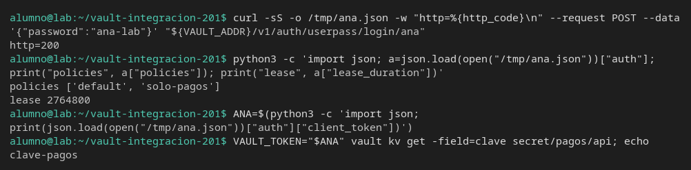
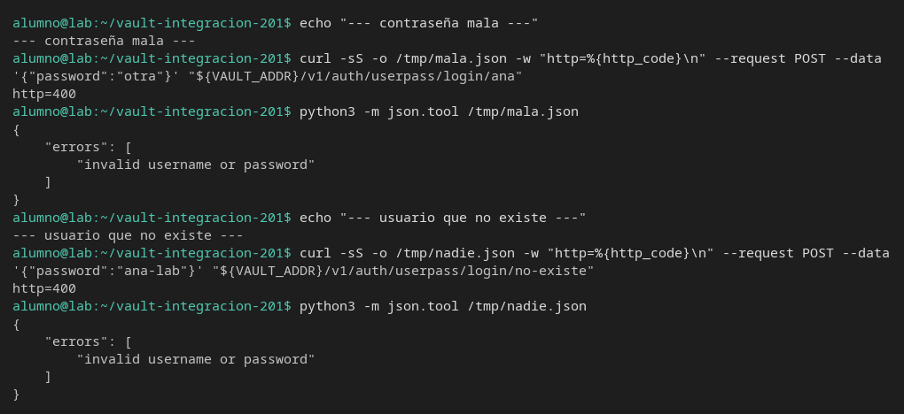
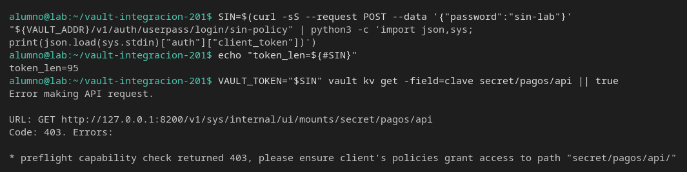
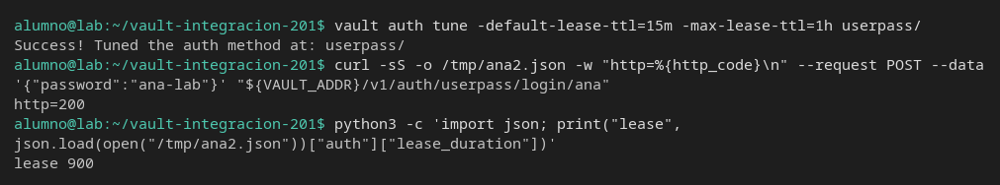

# UserPass

[← Página anterior](01-lab-approle.md) · [Siguiente página →](03-lab-secret-id-un-uso.md)

Una persona no presenta un `secret_id`. Presenta usuario y contraseña, y Vault le da un token. Vas a entrar como `ana`, ver cuánto dura ese token si nadie ha afinado el método, y separar una contraseña mala de un usuario sin permiso.

### Objetivo

Un login de `ana` / `ana-lab` que lee `secret/pagos/api`, un login rechazado con HTTP 400, y el mismo usuario con el token acotado a 15 minutos.

### Punto de partida

```bash
bash infra/reiniciar-vault.sh
source infra/entorno.sh
```

Servidor vacío. UserPass no está habilitado hasta el paso 2.

### En qué consiste

Policy, método UserPass, login bueno, login malo, un usuario que entra y no puede leer, y el ajuste del TTL del método.

### 1 — Secreto y policy

**Acción:**

```bash
vault kv put secret/pagos/api clave=clave-pagos
bash infra/policy.sh solo-pagos <<'EOF'
path "secret/data/pagos/api" {
  capabilities = ["read"]
}
path "secret/metadata/pagos/api" {
  capabilities = ["read"]
}
path "sys/internal/ui/mounts/secret/*" {
  capabilities = ["read"]
}
EOF
```

**Por qué:** el login solo demuestra autenticación. La lectura demuestra que la policy viaja con el usuario.

**Resultado esperado:** `version` `1` y `Policy solo-pagos escrita.`

### 2 — Habilita UserPass y crea dos usuarios

**Acción:**

```bash
vault auth enable userpass
vault write auth/userpass/users/ana password=ana-lab policies=solo-pagos
vault write auth/userpass/users/sin-policy password=sin-lab policies=default
```

**Por qué:** `ana` es quien debe leer pagos. `sin-policy` entra igual de bien y no tiene `solo-pagos`. Si solo pruebas a `ana`, un 403 posterior no tiene con quién compararse.

**Resultado esperado:** `Enabled userpass auth method at: userpass/` y dos `Success! Data written`.

### 3 — Entra como ana

**Acción:**

```bash
curl -sS -o /tmp/ana.json -w "http=%{http_code}\n" --request POST \
  --data '{"password":"ana-lab"}' \
  "${VAULT_ADDR}/v1/auth/userpass/login/ana"
python3 -c 'import json; a=json.load(open("/tmp/ana.json"))["auth"]; print("policies", a["policies"]); print("lease", a["lease_duration"])'
ANA=$(python3 -c 'import json; print(json.load(open("/tmp/ana.json"))["auth"]["client_token"])')
VAULT_TOKEN="$ANA" vault kv get -field=clave secret/pagos/api; echo
```

**Por qué:** el cuerpo trae el token y la duración. Sin afinar el método, el TTL por defecto es largo: un test que asuma «la sesión dura un cuarto de hora» estaría describiendo otro Vault.

**Resultado esperado:** `http=200`. `policies` incluye `default` y `solo-pagos`. `lease` es `2764800` (32 días). La lectura imprime `clave-pagos`.



### 4 — Contraseña mala y usuario que no existe

**Acción:**

```bash
echo "--- contraseña mala ---"
curl -sS -o /tmp/mala.json -w "http=%{http_code}\n" --request POST \
  --data '{"password":"otra"}' \
  "${VAULT_ADDR}/v1/auth/userpass/login/ana"
python3 -m json.tool /tmp/mala.json
echo "--- usuario que no existe ---"
curl -sS -o /tmp/nadie.json -w "http=%{http_code}\n" --request POST \
  --data '{"password":"ana-lab"}' \
  "${VAULT_ADDR}/v1/auth/userpass/login/no-existe"
python3 -m json.tool /tmp/nadie.json
```

**Por qué:** las dos respuestas son iguales. La API no dice si falló la contraseña o el usuario. El test no puede afirmar cuál de los dos fue mirando solo el JSON.

**Resultado esperado:** las dos cabeceras se imprimen, las dos líneas HTTP son `400` y los dos cuerpos dicen `invalid username or password`. No hay `client_token`.



### 5 — Entra quien no tiene la policy

**Acción:**

```bash
SIN=$(curl -sS --request POST --data '{"password":"sin-lab"}' \
  "${VAULT_ADDR}/v1/auth/userpass/login/sin-policy" \
  | python3 -c 'import json,sys; print(json.load(sys.stdin)["auth"]["client_token"])')
echo "token_len=${#SIN}"
VAULT_TOKEN="$SIN" vault kv get -field=clave secret/pagos/api || true
```

**Por qué:** el login ha funcionado. El 403 es de autorización. Mezclarlo con el 400 del paso 4 hace que el informe diga «no puede entrar» cuando sí entró.

**Resultado esperado:** `token_len` mayor que 20. La lectura es 403 en el preflight `sys/internal/ui/mounts/secret/pagos/api`.



### 6 — Acota el TTL del método y vuelve a entrar

**Acción:**

```bash
vault auth tune -default-lease-ttl=15m -max-lease-ttl=1h userpass/
curl -sS -o /tmp/ana2.json -w "http=%{http_code}\n" --request POST \
  --data '{"password":"ana-lab"}' \
  "${VAULT_ADDR}/v1/auth/userpass/login/ana"
python3 -c 'import json; print("lease", json.load(open("/tmp/ana2.json"))["auth"]["lease_duration"])'
```

**Por qué:** el usuario `ana` no se ha reescrito. El siguiente login usa el TTL del método. El token del paso 3 sigue vivo hasta que caduque: afinar no revoca la sesión que ya se emitió.

**Resultado esperado:** `Success! Tuned the auth method at: userpass/`. `http=200` y `lease 900`.



## Comprueba tu entendimiento

**La contraseña buena sigue valiendo**
Repite el `curl` de login de `ana` con `ana-lab`.
→ HTTP 200 y hay `client_token`. El 400 del paso 4 no bloqueó al usuario.

## Reto

### 1 — Cambiar la contraseña

Con `root`, escribe de nuevo a `ana` con `password=ana-nueva` y la misma policy. Prueba la contraseña vieja y la nueva.

<details>
<summary>Ver solución</summary>

```bash
source infra/entorno.sh
vault write auth/userpass/users/ana password=ana-nueva policies=solo-pagos
echo -n "vieja "
curl -sS -o /dev/null -w "http=%{http_code}\n" --request POST \
  --data '{"password":"ana-lab"}' \
  "${VAULT_ADDR}/v1/auth/userpass/login/ana"
echo -n "nueva "
curl -sS -o /dev/null -w "http=%{http_code}\n" --request POST \
  --data '{"password":"ana-nueva"}' \
  "${VAULT_ADDR}/v1/auth/userpass/login/ana"
```

La vieja es `http=400`. La nueva es `http=200`.

</details>

## Errores frecuentes

| Síntoma | Causa probable | Cómo arreglarlo |
|---------|----------------|-----------------|
| `no handler for route` en el login | `vault auth enable userpass` no se ejecutó | Repite el paso 2 |
| `lease` ya sale `900` en el paso 3 | El método se afinó en este contenedor antes de tiempo | `bash infra/reiniciar-vault.sh`, `source infra/entorno.sh` y desde el paso 1 |
| 403 leyendo como `ana` | La policy no está en el usuario | `vault read auth/userpass/users/ana` y mira `token_policies` |
