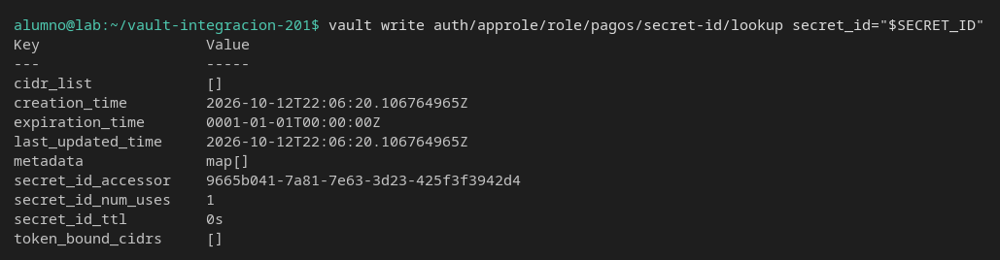
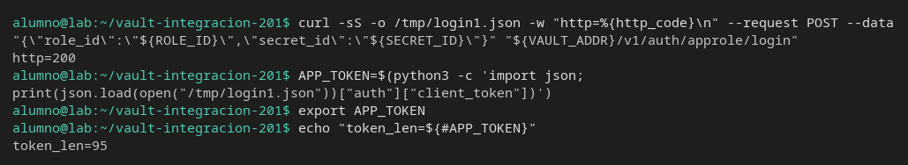
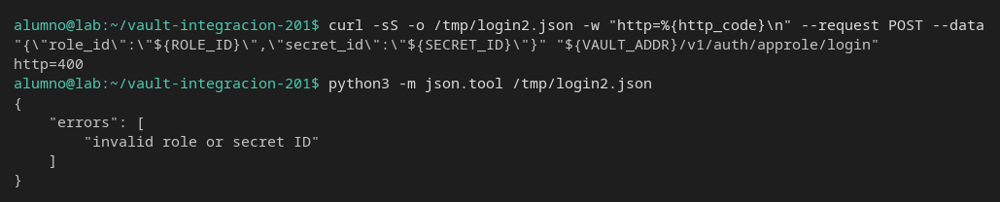
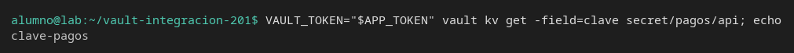
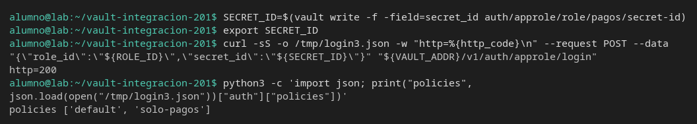

# secret_id de un solo uso

[← Página anterior](02-lab-userpass.md) · [Siguiente página →](../M05-integracion-aplicaciones/README.md)

Un pipeline que guarda el `secret_id` y lo reutiliza en el siguiente job falla en el segundo login. El token del primer login sigue siendo válido: no es el mismo objeto.

### Objetivo

Un rol con `secret_id_num_uses=1` cuyo segundo login responde 400, mientras el token del primero todavía lee `secret/pagos/api`.

### Punto de partida

```bash
bash infra/reiniciar-vault.sh
source infra/entorno.sh
unset ROLE_ID SECRET_ID APP_TOKEN
```

Servidor vacío. AppRole se habilita aquí.

### En qué consiste

Policy, rol de un solo uso, primer login, segundo login con el mismo `secret_id`, lectura con el token ya emitido y un `secret_id` nuevo.

### 1 — Secreto, policy y rol

**Acción:**

```bash
vault kv put secret/pagos/api clave=clave-pagos
bash infra/policy.sh solo-pagos <<'EOF'
path "secret/data/pagos/api" {
  capabilities = ["read"]
}
path "secret/metadata/pagos/api" {
  capabilities = ["read"]
}
path "sys/internal/ui/mounts/secret/*" {
  capabilities = ["read"]
}
EOF
vault auth enable approle
vault write auth/approle/role/pagos \
  token_policies=solo-pagos \
  token_ttl=15m \
  token_max_ttl=1h \
  secret_id_num_uses=1
```

**Por qué:** `secret_id_num_uses=1` está en el rol, no en el secreto de pagos. Cada `secret_id` que emitas después solo sirve para un login. El token que sale de ese login es otra credencial, con su propio TTL.

**Resultado esperado:** policy escrita, AppRole habilitado y `Success! Data written to: auth/approle/role/pagos`.

### 2 — Emite un secret_id y míralo

**Acción:**

```bash
ROLE_ID=$(vault read -field=role_id auth/approle/role/pagos/role-id)
SECRET_ID=$(vault write -f -field=secret_id auth/approle/role/pagos/secret-id)
export ROLE_ID SECRET_ID
vault write auth/approle/role/pagos/secret-id/lookup secret_id="$SECRET_ID"
```

**Por qué:** el lookup dice cuántos usos le quedan a este identificador antes de gastarlo. Si el campo no es `1`, el paso 4 no va a fallar como esperas.

**Resultado esperado:** `secret_id_num_uses` es `1` y `secret_id_ttl` es `0s`. `expiration_time` en el año 0001 quiere decir que este identificador no caduca por reloj: el límite es el número de usos. `role_id` y `secret_id` no salen vacíos si haces `echo "$ROLE_ID"` y `echo "$SECRET_ID"`.



### 3 — Primer login

**Acción:**

```bash
curl -sS -o /tmp/login1.json -w "http=%{http_code}\n" --request POST \
  --data "{\"role_id\":\"${ROLE_ID}\",\"secret_id\":\"${SECRET_ID}\"}" \
  "${VAULT_ADDR}/v1/auth/approle/login"
APP_TOKEN=$(python3 -c 'import json; print(json.load(open("/tmp/login1.json"))["auth"]["client_token"])')
export APP_TOKEN
echo "token_len=${#APP_TOKEN}"
```

**Por qué:** este login consume el único uso. Hay que guardar el `client_token` ahora: el `secret_id` no volverá a entregarlo.

**Resultado esperado:** `http=200` y `token_len` mayor que 20.



### 4 — Segundo login con el mismo secret_id

**Acción:**

```bash
curl -sS -o /tmp/login2.json -w "http=%{http_code}\n" --request POST \
  --data "{\"role_id\":\"${ROLE_ID}\",\"secret_id\":\"${SECRET_ID}\"}" \
  "${VAULT_ADDR}/v1/auth/approle/login"
python3 -m json.tool /tmp/login2.json
```

**Por qué:** es el job que reutiliza la variable del pipeline. El cuerpo es el mismo que el de un `secret_id` inventado: `invalid role or secret ID`. El HTTP no dice «ya usado».

**Resultado esperado:** `http=400` y `invalid role or secret ID`. No hay `client_token`.



### 5 — El token del primer login sigue leyendo

**Acción:**

```bash
VAULT_TOKEN="$APP_TOKEN" vault kv get -field=clave secret/pagos/api; echo
```

**Por qué:** gastar el `secret_id` no revoca el token. Si el test mata el job porque el segundo login falló, puede estar tirando una sesión que todavía lee el secreto.

**Resultado esperado:** `clave-pagos`.



### 6 — Un secret_id nuevo

**Acción:**

```bash
SECRET_ID=$(vault write -f -field=secret_id auth/approle/role/pagos/secret-id)
export SECRET_ID
curl -sS -o /tmp/login3.json -w "http=%{http_code}\n" --request POST \
  --data "{\"role_id\":\"${ROLE_ID}\",\"secret_id\":\"${SECRET_ID}\"}" \
  "${VAULT_ADDR}/v1/auth/approle/login"
python3 -c 'import json; print("policies", json.load(open("/tmp/login3.json"))["auth"]["policies"])'
```

**Por qué:** el rol no se ha agotado. Se agotó un identificador. El arreglo del pipeline es pedir otro `secret_id`, no crear otro rol.

**Resultado esperado:** `http=200` y `policies` incluye `solo-pagos`.



## Comprueba tu entendimiento

**El secret_id del paso 4 sigue sin valer**
Repite el `curl` del paso 4 con el `SECRET_ID` que tenía antes del paso 6. Si ya lo pisaste, el que falló es el que guardaste en `/tmp/login2.json`: no va a recuperar el identificador. Vuelve a emitir uno, haz login una vez y repite el POST.
→ El segundo POST de ese identificador es HTTP 400.

## Reto

### 1 — Dos usos, no uno

Crea el rol `dos` con `secret_id_num_uses=2` y la policy `solo-pagos`. Emite un `secret_id` y haz login tres veces.

<details>
<summary>Ver solución</summary>

```bash
source infra/entorno.sh
vault write auth/approle/role/dos \
  token_policies=solo-pagos \
  token_ttl=15m \
  token_max_ttl=1h \
  secret_id_num_uses=2
R=$(vault read -field=role_id auth/approle/role/dos/role-id)
S=$(vault write -f -field=secret_id auth/approle/role/dos/secret-id)
for i in 1 2 3; do
  echo -n "login $i "
  curl -sS -o /tmp/n.json -w "http=%{http_code}\n" --request POST \
    --data "{\"role_id\":\"${R}\",\"secret_id\":\"${S}\"}" \
    "${VAULT_ADDR}/v1/auth/approle/login"
done
```

Los logins 1 y 2 son `http=200`. El 3 es `http=400`.

</details>

## Errores frecuentes

| Síntoma | Causa probable | Cómo arreglarlo |
|---------|----------------|-----------------|
| El segundo login también es 200 | El rol no tiene `secret_id_num_uses=1` | `vault read auth/approle/role/pagos` y mira ese campo. Si es `0`, no hay límite |
| El primer login ya es 400 | Reutilizaste un `secret_id` de un intento anterior | Emite otro con `vault write -f -field=secret_id ...` |
| El paso 5 dice `invalid token` | `APP_TOKEN` es el de un login fallido o está vacío | Tiene que salir del JSON del paso 3, el que fue HTTP 200 |
