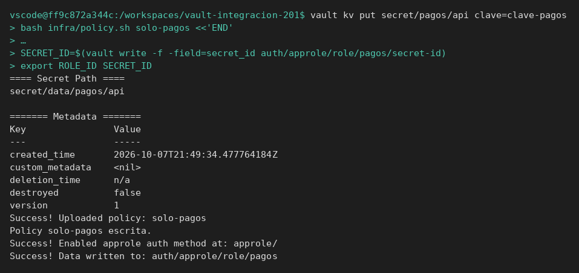
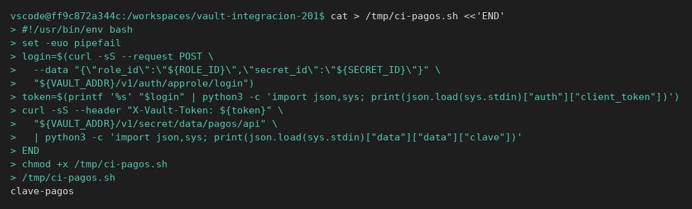

# Integrar una aplicación

[← Página anterior](README.md) · [Siguiente página →](01-lab-consumo-automatico.md)

La aplicación de pagos necesita `clave` y no debe conocer el token `root`. Esta página monta ese contrato desde cero.

## Punto de partida

```bash
bash infra/reiniciar-vault.sh
source infra/entorno.sh
```

## Recorrido

1. El secreto, la policy de solo lectura y el rol AppRole `pagos` existen antes de escribir la aplicación. El despliegue recibe `role_id` y `secret_id`. No recibe la clave de la API: esa la pide después.

```bash
vault kv put secret/pagos/api clave=clave-pagos
bash infra/policy.sh solo-pagos <<'EOF'
path "secret/data/pagos/api" {
  capabilities = ["read"]
}
path "secret/metadata/pagos/api" {
  capabilities = ["read"]
}
path "sys/internal/ui/mounts/secret/*" {
  capabilities = ["read"]
}
EOF
vault auth enable approle
vault write auth/approle/role/pagos token_policies=solo-pagos token_ttl=15m token_max_ttl=1h
```

El secreto queda en versión `1`, la policy se registra y AppRole queda habilitado.



2. El job de CI hace tres cosas y se termina: leer los identificadores del entorno, hacer POST a `/v1/auth/approle/login`, hacer GET a `/v1/secret/data/pagos/api` con el token devuelto. La clave que imprime es `clave-pagos`. El token `root` no aparece en el script.



3. Vault Agent repite ese login él solo. Lee `role_id` y `secret_id` de ficheros, pide el token y renderiza la plantilla en `/tmp/clave-render.txt`. El fichero contiene solo `clave-pagos`. La aplicación que «no sabe Vault» leería ese fichero.


La plantilla pide `secret/data/pagos/api` y se queda con `.Data.data.clave`. Si el campo no se llama `clave`, el fichero contiene `<no value>`. El test tiene que decirlo así, no como «Agent no arranca».

## Qué queda visto

Hay dos sitios donde puede vivir la integración: un script que llama a la API, o un fichero renderizado. El [laboratorio](01-lab-consumo-automatico.md) los construye otra vez, con servidor limpio.
