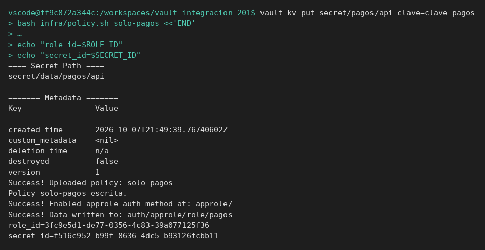
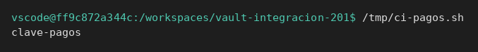
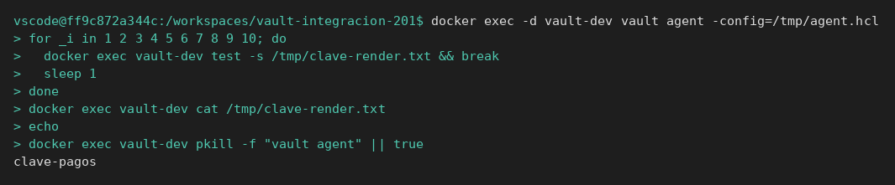
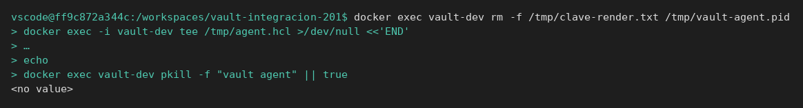
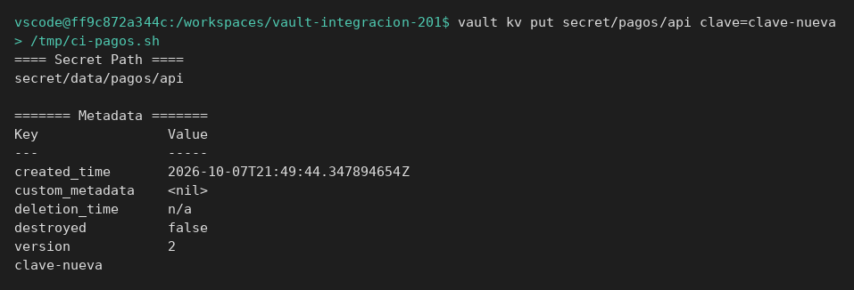

# Consumo automático

[← Página anterior](00-integrar-aplicacion.md) · [Siguiente página →](02-lab-job-falla-cerrado.md)

Vas a dejar un script que obtiene la clave sin usar `root`, y un Vault Agent que escribe esa misma clave en un fichero.

### Objetivo

`/tmp/ci-pagos.sh` imprime `clave-pagos`, y `/tmp/clave-render.txt` dentro del contenedor contiene exactamente esa cadena.

### Punto de partida

```bash
bash infra/reiniciar-vault.sh
source infra/entorno.sh
```

Servidor vacío. AppRole se habilita en el paso 2. No reutilices identificadores de otro laboratorio: el reinicio los ha borrado.

### En qué consiste

Preparar secreto, policy y rol; escribir el script de CI; ejecutarlo; generar la config de Agent dentro del contenedor y leer el fichero renderizado.

### 1 — Secreto, policy y rol

**Acción:**

```bash
vault kv put secret/pagos/api clave=clave-pagos
bash infra/policy.sh solo-pagos <<'EOF'
path "secret/data/pagos/api" {
  capabilities = ["read"]
}
path "secret/metadata/pagos/api" {
  capabilities = ["read"]
}
path "sys/internal/ui/mounts/secret/*" {
  capabilities = ["read"]
}
EOF
vault auth enable approle
vault write auth/approle/role/pagos \
  token_policies=solo-pagos \
  token_ttl=15m \
  token_max_ttl=1h
ROLE_ID=$(vault read -field=role_id auth/approle/role/pagos/role-id)
SECRET_ID=$(vault write -f -field=secret_id auth/approle/role/pagos/secret-id)
export ROLE_ID SECRET_ID
```

**Por qué:** el script solo conocerá estos dos identificadores. Si le pasas `VAULT_TOKEN=root`, no estás probando la integración.

**Resultado esperado:** `echo "$ROLE_ID"` y `echo "$SECRET_ID"` muestran dos valores distintos y no vacíos.



### 2 — Escribe el script del pipeline

**Acción:**

```bash
cat > /tmp/ci-pagos.sh <<'EOF'
#!/usr/bin/env bash
set -euo pipefail
login=$(curl -sS --request POST \
  --data "{\"role_id\":\"${ROLE_ID}\",\"secret_id\":\"${SECRET_ID}\"}" \
  "${VAULT_ADDR}/v1/auth/approle/login")
token=$(printf '%s' "$login" | python3 -c 'import json,sys; print(json.load(sys.stdin)["auth"]["client_token"])')
curl -sS --header "X-Vault-Token: ${token}" \
  "${VAULT_ADDR}/v1/secret/data/pagos/api" \
  | python3 -c 'import json,sys; print(json.load(sys.stdin)["data"]["data"]["clave"])'
EOF
chmod +x /tmp/ci-pagos.sh
```

**Por qué:** es el job. Login y lectura, nada más. El token vive en una variable local y no se imprime.

**Resultado esperado:** el fichero existe y es ejecutable. Todavía no ha llamado a Vault.

### 3 — Ejecuta el script

**Acción:**

```bash
/tmp/ci-pagos.sh
```

**Por qué:** este es el camino feliz de la integración. El módulo 6 parte de este mismo gesto y lo rompe.

**Resultado esperado:** una línea, `clave-pagos`.



> [!WARNING]
> Si el script falla con `ROLE_ID`, las variables se perdieron al cambiar de terminal. Repite las dos líneas `ROLE_ID=$(...)` y `SECRET_ID=$(...)` y el `export`. No hace falta reescribir el script.

### 4 — Prepara los ficheros que leerá Vault Agent

**Acción:**

```bash
printf '%s' "$ROLE_ID" | docker exec -i vault-dev tee /tmp/role_id >/dev/null
printf '%s' "$SECRET_ID" | docker exec -i vault-dev tee /tmp/secret_id >/dev/null
docker exec -i vault-dev tee /tmp/agent.hcl >/dev/null <<'EOF'
pid_file = "/tmp/vault-agent.pid"

vault {
  address = "http://127.0.0.1:8200"
}

auto_auth {
  method "approle" {
    config = {
      role_id_file_path = "/tmp/role_id"
      secret_id_file_path = "/tmp/secret_id"
      remove_secret_id_file_after_reading = false
    }
  }
}

template {
  contents = "{{ with secret \"secret/data/pagos/api\" }}{{ .Data.data.clave }}{{ end }}"
  destination = "/tmp/clave-render.txt"
}
EOF
```

**Por qué:** Agent no usa tu `VAULT_TOKEN`. Lee los ficheros, entra con AppRole y escribe la plantilla. Se deja en marcha: si se le pide salir justo después del login, el fichero puede quedar sin escribir.

**Resultado esperado:** los tres `tee` terminan sin error. No hay salida.

### 5 — Arranca Agent y lee el fichero

**Acción:**

```bash
docker exec -d vault-dev vault agent -config=/tmp/agent.hcl
for _i in 1 2 3 4 5 6 7 8 9 10; do
  docker exec vault-dev test -s /tmp/clave-render.txt && break
  sleep 1
done
docker exec vault-dev cat /tmp/clave-render.txt
echo
docker exec vault-dev pkill -f "vault agent" || true
```

**Por qué:** el fichero es lo que consumiría la aplicación que no habla con Vault. El test de esta integración compara el fichero con `clave-pagos`, no la salida de un `vault kv get` hecho con `root`. El `pkill` para el Agent para que no siga renovando el token en segundo plano.

**Resultado esperado:** `cat` imprime `clave-pagos`. El bucle no tiene que agotar los 10 intentos.



## Comprueba tu entendimiento

**Campo que no existe**
Cambia en tu cabeza la plantilla a `.Data.data.password` y vuelve a escribir `/tmp/agent.hcl` con ese campo. Arranca Agent otra vez.
→ El proceso puede terminar bien y el fichero contiene el texto `<no value>`. La plantilla de Go imprime eso cuando el campo no existe. No es un fichero vacío y no es un fallo de login: es el contrato del campo.



## Reto

### 1 — El script tras una rotación

Escribe la versión 2 con `clave=clave-nueva` y ejecuta otra vez `/tmp/ci-pagos.sh` sin tocar el script.

<details>
<summary>Ver solución</summary>

```bash
vault kv put secret/pagos/api clave=clave-nueva
/tmp/ci-pagos.sh
```

Imprime `clave-nueva`. El script no tiene la clave escrita dentro: la pide cada vez.



</details>

## Errores frecuentes

| Síntoma | Causa probable | Cómo arreglarlo |
|---------|----------------|-----------------|
| `ROLE_ID: unbound variable` | No exportaste los ids en esta terminal | Repite el final del paso 1 |
| Agent: `permission denied` al renderizar | El rol no tiene `solo-pagos` o la policy no lleva `secret/data/` | `vault read auth/approle/role/pagos` y `vault policy read solo-pagos` |
| El fichero no aparece | Agent no ha llegado a renderizar o la policy no deja leer | `docker logs` no aplica: `docker exec vault-dev ps` y repite el paso 5. Si sigue vacío, revisa la policy del paso 1 |
| El fichero tiene comillas o saltos de más | La plantilla imprime otra cosa además de la clave | Vuelve a copiar el bloque `contents` del paso 4 |
