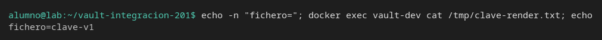
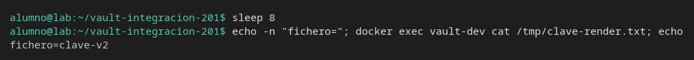

# Agent y el cambio en caliente

[← Página anterior](02-lab-job-falla-cerrado.md) · [Siguiente página →](../M06-testing-integraciones/README.md)

Vault Agent escribe el secreto en un fichero. Con un KV v2 ese secreto no tiene lease, así que Agent no se entera de una rotación salvo que le digas cada cuánto volver a renderizar. Vas a ver el fichero cambiar sin reiniciar la aplicación.

### Objetivo

Dejar `/tmp/clave-render.txt` dentro del contenedor con `clave-v1` y, tras otra escritura, con `clave-v2`, sin volver a arrancar Agent.

### Punto de partida

```bash
bash infra/reiniciar-vault.sh
source infra/entorno.sh
```

Servidor vacío. Agent se arranca en esta página y se para al final.

### En qué consiste

AppRole, la configuración de Agent con intervalo de render, la primera lectura del fichero, la rotación y la segunda lectura.

### 1 — Secreto, policy y rol

**Acción:**

```bash
vault kv put secret/pagos/api clave=clave-v1
bash infra/policy.sh solo-pagos <<'EOF'
path "secret/data/pagos/api" {
  capabilities = ["read"]
}
path "secret/metadata/pagos/api" {
  capabilities = ["read"]
}
path "sys/internal/ui/mounts/secret/*" {
  capabilities = ["read"]
}
EOF
vault auth enable approle
vault write auth/approle/role/pagos \
  token_policies=solo-pagos \
  token_ttl=15m \
  token_max_ttl=1h
ROLE_ID=$(vault read -field=role_id auth/approle/role/pagos/role-id)
SECRET_ID=$(vault write -f -field=secret_id auth/approle/role/pagos/secret-id)
export ROLE_ID SECRET_ID
echo "role_len=${#ROLE_ID} secret_len=${#SECRET_ID}"
```

**Por qué:** Agent entra con AppRole. El `secret_id` de este rol no tiene límite de usos: Agent lo lee del fichero y puede volver a autenticarse al renovar.

**Resultado esperado:** las dos longitudes son mayores que 10.

### 2 — Deja los ficheros de Agent

**Acción:**

```bash
printf '%s' "$ROLE_ID" | docker exec -i vault-dev tee /tmp/role_id >/dev/null
printf '%s' "$SECRET_ID" | docker exec -i vault-dev tee /tmp/secret_id >/dev/null
docker exec -i vault-dev tee /tmp/agent.hcl >/dev/null <<'EOF'
pid_file = "/tmp/vault-agent.pid"

vault {
  address = "http://127.0.0.1:8200"
}

auto_auth {
  method "approle" {
    config = {
      role_id_file_path = "/tmp/role_id"
      secret_id_file_path = "/tmp/secret_id"
      remove_secret_id_file_after_reading = false
    }
  }
}

template_config {
  static_secret_render_interval = "5s"
}

template {
  contents = "{{ with secret \"secret/data/pagos/api\" }}{{ .Data.data.clave }}{{ end }}"
  destination = "/tmp/clave-render.txt"
}
EOF
```

**Por qué:** la lectura de un KV v2 vuelve con `lease_duration` 0. Sin `static_secret_render_interval`, Agent renderiza una vez y el fichero se queda en el valor viejo aunque tú escribas la versión 2. Cinco segundos es el ritmo de este laboratorio, no una recomendación de producción.

**Resultado esperado:** los tres `tee` terminan sin salida.

### 3 — Arranca Agent y lee la primera versión

**Acción:**

```bash
docker exec vault-dev rm -f /tmp/clave-render.txt
docker exec -d vault-dev vault agent -config=/tmp/agent.hcl
for _i in 1 2 3 4 5 6 7 8 9 10; do
  docker exec vault-dev test -s /tmp/clave-render.txt && break
  sleep 1
done
echo -n "fichero="; docker exec vault-dev cat /tmp/clave-render.txt; echo
```

**Por qué:** el fichero es la interfaz de la aplicación. El test compara esa cadena, no un `vault kv get` hecho con `root`.

**Resultado esperado:** `fichero=clave-v1`. El bucle no agota los 10 intentos.



### 4 — Rota el secreto y espera el intervalo

**Acción:**

```bash
vault kv put secret/pagos/api clave=clave-v2
sleep 8
echo -n "fichero="; docker exec vault-dev cat /tmp/clave-render.txt; echo
```

**Por qué:** nadie reinicia Agent ni la aplicación. A los cinco segundos Agent vuelve a pedir el secreto y reescribe el fichero. Ocho segundos dejan margen para ese ciclo.

**Resultado esperado:** `fichero=clave-v2`.



### 5 — Para Agent

**Acción:**

```bash
docker exec vault-dev pkill -f "vault agent" || true
```

**Por qué:** si lo dejas corriendo, el siguiente laboratorio de esta terminal sigue teniendo un proceso que escribe `/tmp/clave-render.txt` por su cuenta.

**Resultado esperado:** el comando termina. No imprime la clave.

> [!WARNING]
> `static_secret_render_interval` hace que Agent siga leyendo el secreto mientras el proceso viva. No lo dejes en marcha al cerrar el ejercicio.

## Comprueba tu entendimiento

**El proceso es quien actualiza el fichero**
Con Agent ya parado, `vault kv put secret/pagos/api clave=clave-v3` y, sin esperar, `docker exec vault-dev cat /tmp/clave-render.txt`.
→ El fichero sigue en `clave-v2`. No hay nadie renderizando.

## Reto

### 1 — Vuelve a arrancar y recoge la versión 3

Si hiciste la comprobación, el secreto ya es `clave-v3` y el fichero no. Arranca Agent otra vez con la misma config y espera a que el fichero coincida.

<details>
<summary>Ver solución</summary>

```bash
docker exec -d vault-dev vault agent -config=/tmp/agent.hcl
for _i in 1 2 3 4 5 6 7 8 9 10; do
  docker exec vault-dev test -s /tmp/clave-render.txt && break
  sleep 1
done
sleep 8
echo -n "fichero="; docker exec vault-dev cat /tmp/clave-render.txt; echo
docker exec vault-dev pkill -f "vault agent" || true
```

`fichero=clave-v3`. El `sleep 8` cubre el intervalo si el primer render todavía vio el valor anterior.

</details>

## Errores frecuentes

| Síntoma | Causa probable | Cómo arreglarlo |
|---------|----------------|-----------------|
| El fichero no aparece | Agent no arrancó o la policy no deja leer | `docker exec vault-dev ps` y busca `vault agent`. Si no está, repite el paso 3 y mira `docker exec vault-dev vault agent -config=/tmp/agent.hcl` en primer plano un momento |
| El paso 4 sigue en `clave-v1` | Falta `static_secret_render_interval` o no esperaste | Revisa `/tmp/agent.hcl` dentro del contenedor y espera otro ciclo de 8 segundos |
| El fichero dice `<no value>` | La plantilla no usa `.Data.data.clave` | Vuelve a copiar el bloque `template` del paso 2 |
