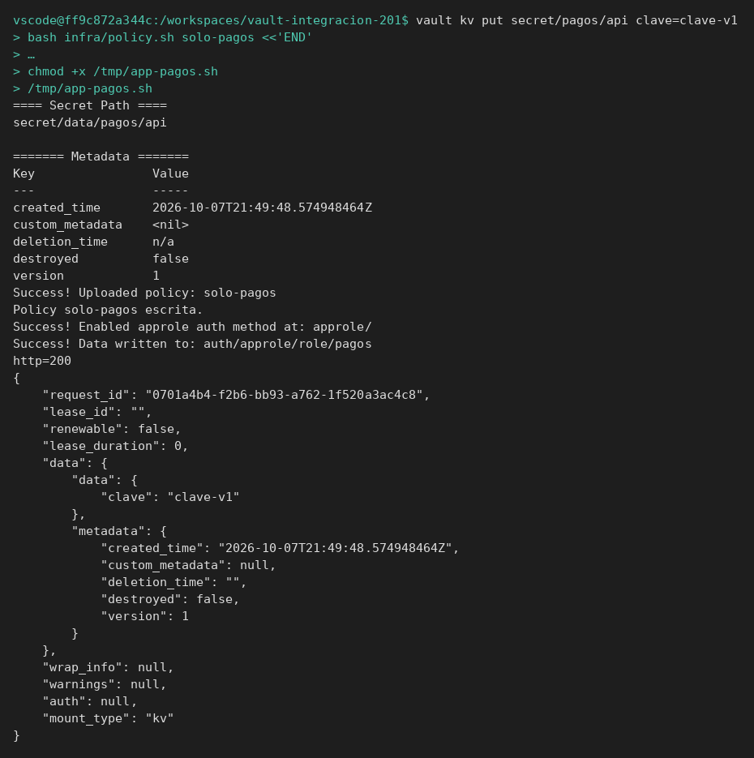
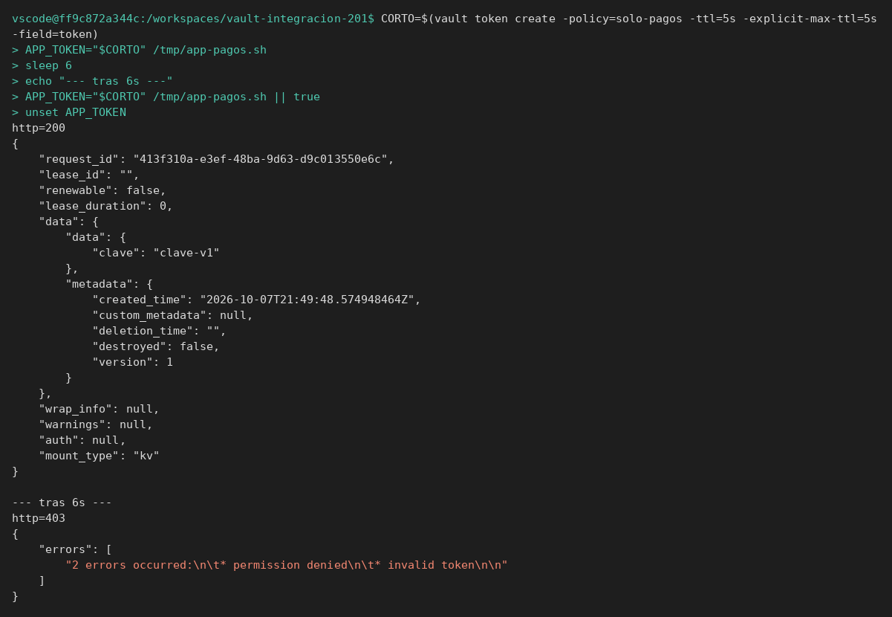
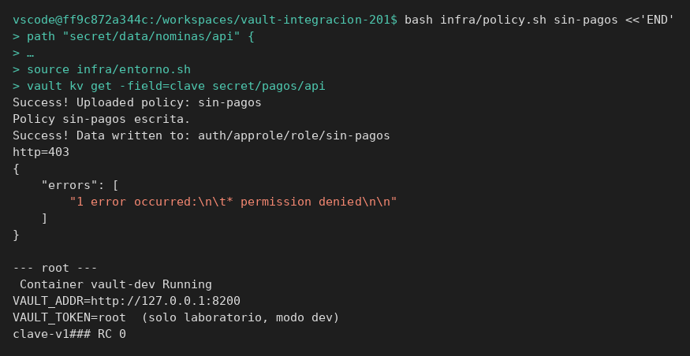
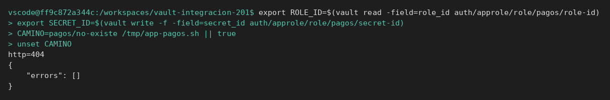
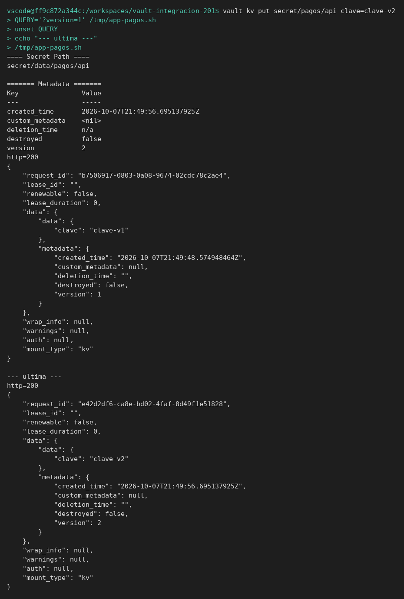
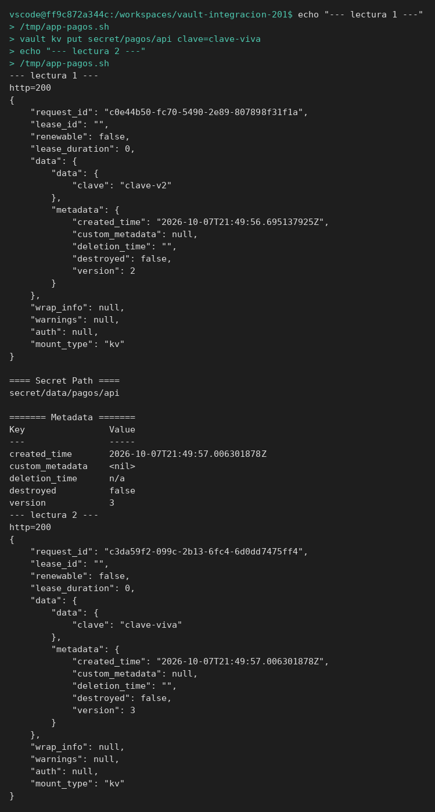
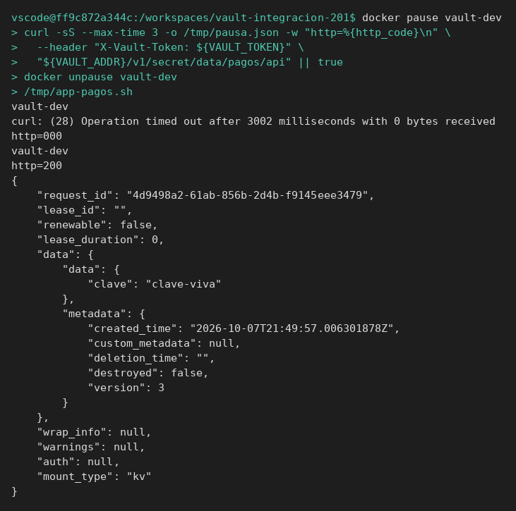
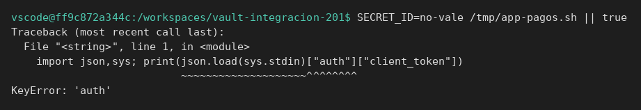

# Escenarios de fallo

[← Página anterior](00-disenar-pruebas.md) · [Siguiente página →](02-lab-checklist.md)

Vas a construir la aplicación de pagos y provocar, uno a uno, los fallos del temario. Cada paso dice el resultado antes de que mires la pantalla.

### Objetivo

Dejar anotado, con una salida real, el caso feliz y estos seis: token caducado, permiso denegado, secreto ausente, versión vieja tras rotar, lectura en caliente y Vault en pausa.

### Punto de partida

```bash
bash infra/reiniciar-vault.sh
source infra/entorno.sh
unset APP_TOKEN CAMINO QUERY
```

Servidor vacío. El script de la aplicación se escribe en esta página. `unset` evita que un `APP_TOKEN` de otro ejercicio en esta misma terminal se cuele en el script y convierta el caso feliz en un 403 de token muerto.

### En qué consiste

Un script `/tmp/app-pagos.sh` que usa AppRole salvo que le pases `APP_TOKEN`. Los pasos cambian Vault o el entorno y vuelven a lanzar el script.

### 1 — Deja el caso feliz listo

**Acción:**

```bash
vault kv put secret/pagos/api clave=clave-v1
bash infra/policy.sh solo-pagos <<'EOF'
path "secret/data/pagos/api" {
  capabilities = ["read"]
}
path "secret/data/pagos/no-existe" {
  capabilities = ["read"]
}
path "secret/metadata/pagos/*" {
  capabilities = ["read"]
}
path "sys/internal/ui/mounts/secret/*" {
  capabilities = ["read"]
}
EOF
vault auth enable approle
vault write auth/approle/role/pagos token_policies=solo-pagos token_ttl=15m token_max_ttl=1h
export ROLE_ID=$(vault read -field=role_id auth/approle/role/pagos/role-id)
export SECRET_ID=$(vault write -f -field=secret_id auth/approle/role/pagos/secret-id)

cat > /tmp/app-pagos.sh <<'EOF'
#!/usr/bin/env bash
set -euo pipefail
if [[ -n "${APP_TOKEN:-}" ]]; then
  token="$APP_TOKEN"
else
  login=$(curl -sS --request POST \
    --data "{\"role_id\":\"${ROLE_ID}\",\"secret_id\":\"${SECRET_ID}\"}" \
    "${VAULT_ADDR}/v1/auth/approle/login")
  token=$(printf '%s' "$login" | python3 -c 'import json,sys; print(json.load(sys.stdin)["auth"]["client_token"])')
fi
url="${VAULT_ADDR}/v1/secret/data/${CAMINO:-pagos/api}${QUERY:-}"
code=$(curl -sS --max-time 5 -o /tmp/app-body.json -w "%{http_code}" \
  --header "X-Vault-Token: ${token}" "$url" || echo "000")
echo "http=${code}"
python3 -m json.tool /tmp/app-body.json 2>/dev/null || true
echo
EOF
chmod +x /tmp/app-pagos.sh
/tmp/app-pagos.sh
```

**Por qué:** sin el 200 de referencia, un fallo posterior no se distingue de «el script nunca funcionó». La policy ya incluye el camino que aún no existe, para que el 404 del paso 4 sea por el dato y no por un 403.

**Resultado esperado:** `http=200` y en el JSON `"clave":"clave-v1"`.



### 2 — Token caducado

**Acción:**

```bash
CORTO=$(vault token create -policy=solo-pagos -ttl=5s -explicit-max-ttl=5s -field=token)
APP_TOKEN="$CORTO" /tmp/app-pagos.sh
sleep 6
APP_TOKEN="$CORTO" /tmp/app-pagos.sh || true
unset APP_TOKEN
```

**Por qué:** la aplicación reutiliza un token que ya no vale. No es un problema del secreto ni del AppRole: por eso se fuerza `APP_TOKEN` y no se hace login nuevo.

**Resultado esperado:** la primera ejecución es `http=200` y muestra `clave-v1`. La segunda, tras la espera, es `http=403`. El cuerpo lleva `invalid token` y no muestra `clave-v1`.



### 3 — Permiso insuficiente

**Acción:**

```bash
bash infra/policy.sh sin-pagos <<'EOF'
path "secret/data/nominas/api" {
  capabilities = ["read"]
}
path "sys/internal/ui/mounts/secret/*" {
  capabilities = ["read"]
}
EOF
vault write auth/approle/role/sin-pagos token_policies=sin-pagos token_ttl=15m token_max_ttl=1h
export ROLE_ID=$(vault read -field=role_id auth/approle/role/sin-pagos/role-id)
export SECRET_ID=$(vault write -f -field=secret_id auth/approle/role/sin-pagos/secret-id)
/tmp/app-pagos.sh || true
```

**Por qué:** el login de este rol es válido y el secreto de pagos existe. La policy mira otro camino. Es el 403 que más se confunde con «la clave está mal escrita».

**Resultado esperado:** `http=403` y `permission denied`. Comprueba con el token de administración que el dato sigue ahí:



```bash
source infra/entorno.sh
vault kv get -field=clave secret/pagos/api
```

Imprime `clave-v1`. `source` ha devuelto `VAULT_TOKEN` a `root` y ha pisado `ROLE_ID` solo si el script de entorno no lo toca: no lo toca. Aun así, el paso 4 vuelve a exportar el rol `pagos`.

### 4 — Secreto inexistente

**Acción:**

```bash
export ROLE_ID=$(vault read -field=role_id auth/approle/role/pagos/role-id)
export SECRET_ID=$(vault write -f -field=secret_id auth/approle/role/pagos/secret-id)
CAMINO=pagos/no-existe /tmp/app-pagos.sh || true
unset CAMINO
```

**Por qué:** el token de `pagos` puede leer ese camino (la policy del paso 1) y no hay dato. Si fuera un 403, habrías probado otra cosa.

**Resultado esperado:** `http=404`. El cuerpo no trae `clave-v1`.



### 5 — Rotación: la prueba se queda en la versión 1

**Acción:**

```bash
vault kv put secret/pagos/api clave=clave-v2
QUERY='?version=1' /tmp/app-pagos.sh
unset QUERY
/tmp/app-pagos.sh
```

**Por qué:** las dos respuestas son HTTP 200. El defecto está en afirmar la versión nueva cuando la petición pide la 1. Rotación incorrecta, en la prueba, es esta confusión.

**Resultado esperado:** la primera ejecución muestra `clave-v1` y `"version":1`. La segunda muestra `clave-v2` y `"version":2`.



### 6 — Cambio en caliente

**Acción:**

```bash
echo "--- lectura 1 ---"
/tmp/app-pagos.sh
vault kv put secret/pagos/api clave=clave-viva
echo "--- lectura 2 ---"
/tmp/app-pagos.sh
```

**Por qué:** nadie reinicia la aplicación ni Vault. El script pide el secreto cada vez, así que ve el valor nuevo. Una aplicación que caché la clave en memoria no la vería: ese sería otro caso, y habría que decirlo.

**Resultado esperado:** la lectura 1 muestra la clave que hubiera en ese momento (`clave-v2` si no has escrito otra). La lectura 2 muestra `clave-viva`.



### 7 — Vault no responde

**Acción:**

```bash
docker pause vault-dev
curl -sS --max-time 3 -o /tmp/pausa.json -w "http=%{http_code}\n" \
  --header "X-Vault-Token: ${VAULT_TOKEN}" \
  "${VAULT_ADDR}/v1/secret/data/pagos/api" || true
docker unpause vault-dev
/tmp/app-pagos.sh
```

**Por qué:** la pausa congela el proceso sin borrar la memoria. Un `docker restart` en modo dev vaciaría los secretos y mezclaría «caída» con «dato perdido». Tras quitar la pausa, la aplicación vuelve a leer.

**Resultado esperado:** `docker pause` imprime `vault-dev` (el nombre del contenedor). `curl` termina con `curl: (28) Operation timed out` y `http=000`: no hay 200 ni 403. Después de `unpause`, el script muestra `http=200` y `clave-viva`.



> [!WARNING]
> Si cierras la terminal en medio de la pausa, el contenedor se queda congelado y el resto de órdenes no responden. `docker unpause vault-dev` lo suelta.

## Comprueba tu entendimiento

**Login malo, sin llegar al secreto**
`SECRET_ID=no-vale /tmp/app-pagos.sh`
→ El script falla en el login, antes de imprimir `http=200`. Python lanza `KeyError: 'auth'` porque la respuesta no trae `client_token`. No es un 404 del secreto.



## Reto

### 1 — Checklist de un caso

Elige el paso 3 y escribe en tres líneas: preparación, acción, resultado que afirmas. Sin mirar el JSON, tiene que poder corregirlo otra persona.

<details>
<summary>Ver solución</summary>

Preparación: rol AppRole con policy que solo lee `secret/data/nominas/api`, secreto `secret/pagos/api` existente.
Acción: login de ese rol y GET de `secret/data/pagos/api`.
Resultado: HTTP 403, texto `permission denied`, y con el token `root` la clave sigue siendo la que había.

</details>

## Errores frecuentes

| Síntoma | Causa probable | Cómo arreglarlo |
|---------|----------------|-----------------|
| El caso feliz ya es 403 `invalid token` | Quedó `APP_TOKEN` de otro ejercicio en esta terminal | `unset APP_TOKEN` y vuelve a lanzar `/tmp/app-pagos.sh` |
| Todos los pasos dan 400 en el login | `ROLE_ID` o `SECRET_ID` son del rol anterior | Vuelve a exportarlos, como al principio del paso 4 |
| El paso 2 sigue en 200 tras el `sleep` | El TTL no se aplicó (`explicit-max-ttl` ausente) o no esperaste | Repite la creación del token y `sleep 6` |
| Tras el paso 7 no responde nada | El contenedor sigue en pausa | `docker unpause vault-dev` |
| 403 en el secreto inexistente | Estás con el rol `sin-pagos` | Exporta otra vez el `ROLE_ID` del rol `pagos` |
