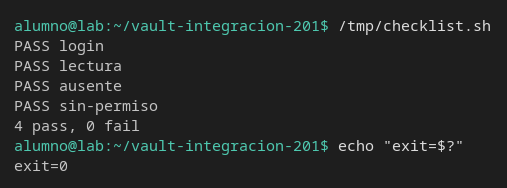

# Checklist ejecutable

[← Página anterior](01-lab-escenarios-de-fallo.md) · [Siguiente página →](03-lab-contrato-de-la-respuesta.md)

La ficha del caso se puede ejecutar. Vas a dejar un script que afirma cuatro cosas y escribe `PASS` o `FAIL` en cada una: login, lectura del campo, secreto ausente y permiso denegado.

### Objetivo

`/tmp/checklist.sh` termina en 0 con cuatro `PASS` cuando el rol `pagos` puede leer `secret/pagos/api` y el rol `sin-pagos` no.

### Punto de partida

```bash
bash infra/reiniciar-vault.sh
source infra/entorno.sh
unset ROLE_ID SECRET_ID SIN_ROLE SIN_SECRET
```

Servidor vacío. El script no hereda un `APP_TOKEN` de otro ejercicio: hace sus propios logins.

### En qué consiste

Dos roles, el script y una ejecución verde. El reto rompe una afirmación a propósito.

### 1 — Secreto y dos roles

**Acción:**

```bash
vault kv put secret/pagos/api clave=clave-pagos
bash infra/policy.sh solo-pagos <<'EOF'
path "secret/data/pagos/api" {
  capabilities = ["read"]
}
path "secret/data/pagos/no-existe" {
  capabilities = ["read"]
}
path "sys/internal/ui/mounts/secret/*" {
  capabilities = ["read"]
}
EOF
bash infra/policy.sh sin-pagos <<'EOF'
path "secret/data/nominas/api" {
  capabilities = ["read"]
}
EOF
vault auth enable approle
vault write auth/approle/role/pagos token_policies=solo-pagos token_ttl=15m token_max_ttl=1h
vault write auth/approle/role/sin-pagos token_policies=sin-pagos token_ttl=15m token_max_ttl=1h
export ROLE_ID=$(vault read -field=role_id auth/approle/role/pagos/role-id)
export SECRET_ID=$(vault write -f -field=secret_id auth/approle/role/pagos/secret-id)
export SIN_ROLE=$(vault read -field=role_id auth/approle/role/sin-pagos/role-id)
export SIN_SECRET=$(vault write -f -field=secret_id auth/approle/role/sin-pagos/secret-id)
echo "listo"
```

**Por qué:** el caso «secreto ausente» necesita permiso de lectura sobre `secret/pagos/no-existe`. Si no está en la policy, el 403 se cuela como si el camino no existiera. `sin-pagos` existe para el 403 de verdad.

**Resultado esperado:** `listo`. Los cuatro identificadores, si haces `echo`, no salen vacíos.

### 2 — Escribe el checklist

**Acción:**

```bash
cat > /tmp/checklist.sh <<'EOF'
#!/usr/bin/env bash
set -u
pasa=0
falla=0
marca() {
  if [[ "$2" == "si" ]]; then
    echo "PASS $1"
    pasa=$((pasa + 1))
  else
    echo "FAIL $1"
    falla=$((falla + 1))
  fi
}
login=$(curl -sS --request POST \
  --data "{\"role_id\":\"${ROLE_ID}\",\"secret_id\":\"${SECRET_ID}\"}" \
  "${VAULT_ADDR}/v1/auth/approle/login")
token=$(printf '%s' "$login" | python3 -c 'import json,sys
try:
    print(json.load(sys.stdin)["auth"]["client_token"])
except Exception:
    print("")')
if [[ -n "$token" ]]; then marca login si; else marca login no; fi

code=$(curl -sS -o /tmp/cuerpo.json -w "%{http_code}" \
  --header "X-Vault-Token: ${token}" \
  "${VAULT_ADDR}/v1/secret/data/pagos/api")
clave=$(python3 -c 'import json
try:
    print(json.load(open("/tmp/cuerpo.json"))["data"]["data"]["clave"])
except Exception:
    print("")')
if [[ "$code" == "200" && "$clave" == "clave-pagos" ]]; then marca lectura si; else marca lectura no; fi

code404=$(curl -sS -o /dev/null -w "%{http_code}" \
  --header "X-Vault-Token: ${token}" \
  "${VAULT_ADDR}/v1/secret/data/pagos/no-existe")
if [[ "$code404" == "404" ]]; then marca ausente si; else marca ausente no; fi

login2=$(curl -sS --request POST \
  --data "{\"role_id\":\"${SIN_ROLE}\",\"secret_id\":\"${SIN_SECRET}\"}" \
  "${VAULT_ADDR}/v1/auth/approle/login")
token2=$(printf '%s' "$login2" | python3 -c 'import json,sys
try:
    print(json.load(sys.stdin)["auth"]["client_token"])
except Exception:
    print("")')
code403=$(curl -sS -o /dev/null -w "%{http_code}" \
  --header "X-Vault-Token: ${token2}" \
  "${VAULT_ADDR}/v1/secret/data/pagos/api")
if [[ "$code403" == "403" ]]; then marca sin-permiso si; else marca sin-permiso no; fi

echo "${pasa} pass, ${falla} fail"
[[ "$falla" == "0" ]]
EOF
chmod +x /tmp/checklist.sh
```

**Por qué:** cada línea `PASS` es una afirmación con resultado escrito en el script, no una impresión que interpretas después. El código de salida es 0 solo si las cuatro pasan.

**Resultado esperado:** el fichero es ejecutable. Aún no hay ningún `PASS`.

### 3 — Ejecútalo

**Acción:**

```bash
/tmp/checklist.sh
echo "exit=$?"
```

**Por qué:** esta es la línea verde de la integración. El módulo de fallos ya te enseñó a romper cada caso por separado; aquí los cuatro viven en una sola orden, que es lo que lanzarías al repetir la prueba.

**Resultado esperado:**

```text
PASS login
PASS lectura
PASS ausente
PASS sin-permiso
4 pass, 0 fail
exit=0
```



## Comprueba tu entendimiento

**El secreto ausente no es un fallo de login**
`CAMINO` no hace falta. Mira la línea `PASS ausente`: el mismo token que leyó `clave-pagos` recibió 404 en `pagos/no-existe`.
→ Si esa línea fuera `FAIL`, el HTTP no fue 404. Lo habitual es un 403 porque quitaste `secret/data/pagos/no-existe` de la policy.

## Reto

### 1 — Una afirmación falsa

Cambia en `/tmp/checklist.sh` la comparación `clave-pagos` por `clave-vieja`, ejecuta y devuelve el texto original.

<details>
<summary>Ver solución</summary>

```bash
sed -i 's/clave-pagos/clave-vieja/' /tmp/checklist.sh
/tmp/checklist.sh || true
sed -i 's/clave-vieja/clave-pagos/' /tmp/checklist.sh
```

`FAIL lectura` y el resto `PASS`. La última línea es `3 pass, 1 fail` y el código de salida no es 0. Al revertir el `sed`, otra ejecución vuelve a `4 pass, 0 fail`.

</details>

## Errores frecuentes

| Síntoma | Causa probable | Cómo arreglarlo |
|---------|----------------|-----------------|
| `FAIL login` | `ROLE_ID` o `SECRET_ID` vacíos en esta terminal | Repite los `export` del paso 1 |
| `FAIL ausente` con el secreto bien creado | La policy de `pagos` no incluye `secret/data/pagos/no-existe` | El 403 no es el 404. Vuelve a escribir `solo-pagos` como en el paso 1 y emite otro `secret_id` |
| `FAIL sin-permiso` | `SIN_ROLE` es el rol `pagos` | `echo "$SIN_ROLE"` tiene que ser el de `auth/approle/role/sin-pagos` |
| `unbound variable` | Falta `export` de alguna de las cuatro variables | Paso 1, otra vez, en esta terminal |
